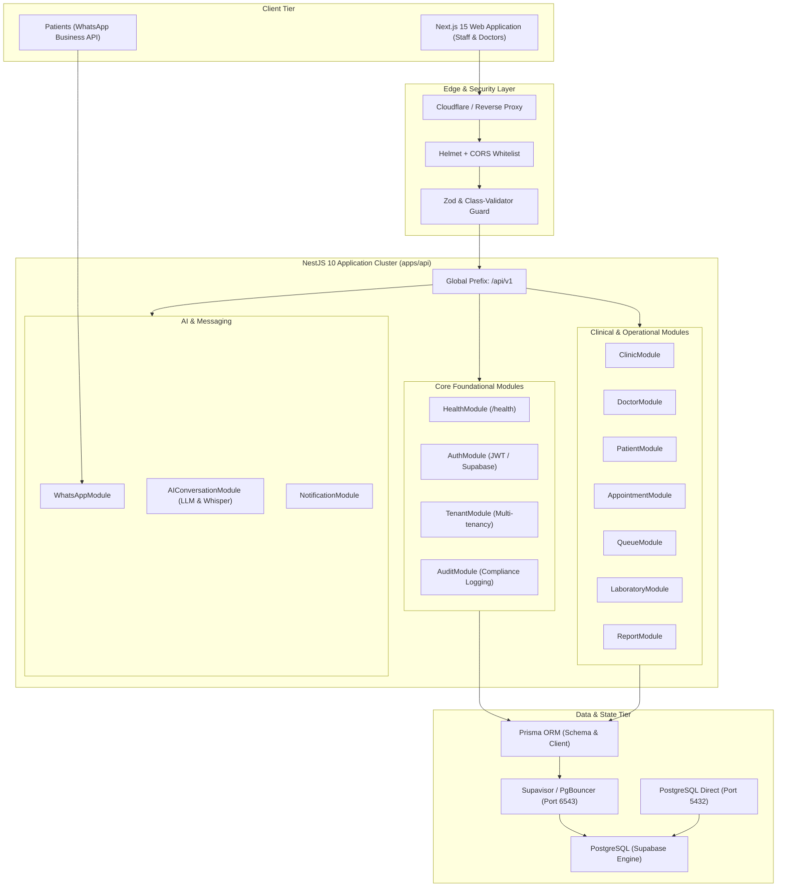

# MatabAI System Architecture

## 1. High-Level Blueprint

MatabAI (ShifaDesk) is an enterprise healthcare SaaS designed for horizontal scalability, zero-trust tenant isolation, and low-latency multilingual interactions.



---

## 2. Monorepo Organization

```text
matabai/
├── apps/
│   ├── web/                 # Next.js 15 App Router Frontend
│   └── api/                 # NestJS 10 REST API
├── packages/
│   ├── shared/              # Pure TypeScript models, contracts, and constants
│   ├── config/              # Shared Tailwind theme, ESLint configs
│   └── validation/          # Shared Zod validation schemas
```

### Module Boundary Isolation
Each NestJS module has a clear boundary:
- **Zero Circular Dependencies**: Modules communicate through defined service injections or event emitters.
- **Tenant Context**: Every operational service receives `TenantContext` to ensure tenant data never mixes across clinic boundaries.
- **Independent Evolution**: The frontend communicates strictly over standardized REST interfaces defined in `@matabai/shared`.

---

## 3. Technology Stack Rationale

| Layer | Technology | Primary Justification |
| :--- | :--- | :--- |
| **Frontend Framework** | Next.js 15 (React 19) | Server Components for instant initial paint, App Router for flexible nested layouts, strong SEO for public clinic portals. |
| **Styling & Components**| Tailwind CSS + Shadcn UI | Accessible, headless primitives (Radix), customizable healthcare design system, high execution velocity. |
| **Client State / Fetching** | TanStack Query v5 | Automatic caching, stale-while-revalidate, optimistic mutations, background synchronization. |
| **Backend Framework** | NestJS 10 | Enterprise architectural patterns (Dependency Injection, Modular boundaries, Interceptors, Pipes), built-in TypeScript strictness. |
| **Database & ORM** | PostgreSQL + Prisma ORM | Relational integrity for medical records, type-safe query generation, automated migrations, Supabase connection pooling support. |
| **API Contract Validation** | Zod + class-validator | Runtime type safety, schema reusability across web client and NestJS backend. |

---

## 4. Phase 0 Module Catalog

In Phase 0, all 13 module boundaries have been initialized as architectural modules inside `apps/api/src/modules/`:
1. `AuthModule`: Identity management, JWT verification, session revocation.
2. `TenantModule`: Multi-tenant organization boundaries, clinic subscriptions.
3. `ClinicModule`: Branch locations, departments, operating schedules.
4. `DoctorModule`: Doctor credentials, specializations, consulting hours.
5. `PatientModule`: Patient demographic records, MRN indexing.
6. `AppointmentModule`: Booking slots, cancellations, conflict prevention.
7. `QueueModule`: Real-time token dispatching, clinic waiting-room screens.
8. `WhatsAppModule`: WhatsApp Cloud API webhook ingestion and message routing.
9. `AIConversationModule`: Multilingual audio ingestion, transcription, structured symptoms extractor.
10. `NotificationModule`: SMS, WhatsApp, and email dispatch engine.
11. `LaboratoryModule`: Diagnostic orders, lab tracking, report storage.
12. `ReportModule`: Revenue metrics, patient volume reporting, exportable PDF generation.
13. `AuditModule`: Tamper-evident logging of sensitive patient record access.
