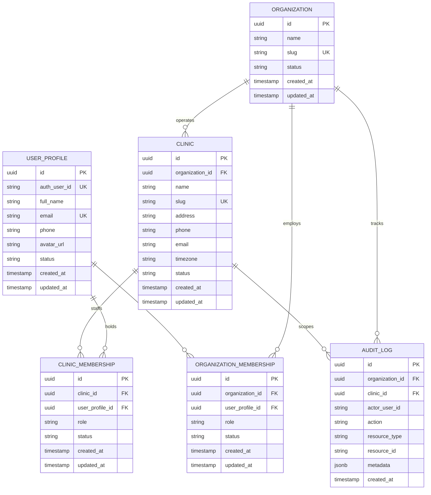

# MatabAI Database Strategy & Schema Reference

Founder: **Muhammad Talha**  
Project: **MatabAI (ShifaDesk)**  
Status: **Phase 2 Complete — Production Schema & Multi-Tenant Foundations Active**

---

## 1. Foundation Overview

MatabAI utilizes PostgreSQL via **Supabase** as its foundational persistence engine, paired with **Prisma ORM** for type-safe queries, connection management, and declarative migrations.

---

## 2. Multi-Tenancy Architecture

MatabAI is a multi-tenant healthcare SaaS where each organization and clinic operates with strict isolation.

### Isolation Strategy: Multi-Tenant Schema with Row-Level Security (RLS)
- Every organizational record references `organization_id` (UUID).
- Clinic-scoped data references `clinic_id` (UUID).
- PostgreSQL Row-Level Security (RLS) policies (`infrastructure/database/rls-policies.sql`) ensure database-level defense in depth.
- Application-level `TenantGuard` in NestJS verifies that the authenticated user holds an active membership before granting access to tenant resources.
- Indexed foreign keys ensure fast joins and eliminate table scans.

---

## 3. Entity Relationship Diagram (Phase 2 Baseline)



---

## 4. Foundational Tables

### 1. `organizations`
Top-level multi-tenant container for healthcare networks and multi-clinic practices.
- `id` (UUID, Primary Key)
- `name` (String, required)
- `slug` (String, unique, URL-safe identifier)
- `status` (`ACTIVE`, `INACTIVE`, `SUSPENDED`)
- `created_at`, `updated_at` (Timestamps)

### 2. `clinics`
Individual healthcare facilities / physical clinics operating under an organization.
- `id` (UUID, Primary Key)
- `organization_id` (UUID, Foreign Key → `organizations.id`)
- `name` (String, required)
- `slug` (String, unique)
- `address` (String, required)
- `phone` (String, required)
- `email` (String, nullable)
- `timezone` (String, default `Asia/Karachi`)
- `status` (`ACTIVE`, `INACTIVE`, `MAINTENANCE`)
- `created_at`, `updated_at` (Timestamps)

### 3. `user_profiles`
Internal user profile linked to Supabase Auth (`auth_user_id`).
- `id` (UUID, Primary Key)
- `auth_user_id` (String, unique, references Supabase Auth `auth.users.id`)
- `full_name` (String, required)
- `email` (String, unique)
- `phone` (String, nullable)
- `avatar_url` (String, nullable)
- `status` (`ACTIVE`, `INACTIVE`, `SUSPENDED`)
- `created_at`, `updated_at` (Timestamps)

### 4. `organization_memberships`
Role assignments scoped to an organization.
- `id` (UUID, Primary Key)
- `organization_id` (UUID, Foreign Key → `organizations.id`)
- `user_profile_id` (UUID, Foreign Key → `user_profiles.id`)
- `role` (`SUPER_ADMIN`, `CLINIC_ADMIN`, `DOCTOR`, `RECEPTIONIST`, `LAB_STAFF`)
- `status` (`ACTIVE`, `INVITED`, `REVOKED`)
- `created_at`, `updated_at` (Timestamps)

### 5. `clinic_memberships`
Role assignments scoped to a specific clinic branch.
- `id` (UUID, Primary Key)
- `clinic_id` (UUID, Foreign Key → `clinics.id`)
- `user_profile_id` (UUID, Foreign Key → `user_profiles.id`)
- `role` (`CLINIC_ADMIN`, `DOCTOR`, `RECEPTIONIST`, `LAB_STAFF`)
- `status` (`ACTIVE`, `INVITED`, `REVOKED`)
- `created_at`, `updated_at` (Timestamps)

### 6. `audit_logs`
Immutable compliance and security audit trail for all write operations.
- `id` (UUID, Primary Key)
- `organization_id` (UUID, Foreign Key → `organizations.id`, nullable)
- `clinic_id` (UUID, Foreign Key → `clinics.id`, nullable)
- `actor_user_id` (String, required, ID of user executing the action)
- `action` (String, e.g. `ORGANIZATION_CREATE`, `CLINIC_UPDATE`, `MEMBERSHIP_DELETE`)
- `resource_type` (String, e.g. `organization`, `clinic`, `membership`)
- `resource_id` (String, nullable)
- `metadata` (JSONB, diffs, IP addresses, client agents)
- `created_at` (Timestamp, defaults to `now()`)

---

## 5. Row-Level Security (RLS) Policies

All multi-tenant tables enforce RLS policies defined in `infrastructure/database/rls-policies.sql`:

1. **Organization Isolation**: Users can only query organizations where they hold an active membership.
2. **Clinic Isolation**: Users can only query clinics belonging to organizations where they hold an active membership.
3. **Audit Log Protection**: Audit logs are append-only. No `UPDATE` or `DELETE` operations are permitted under any circumstances.
4. **Super Admin Bypass**: Service role and global `SUPER_ADMIN` can inspect cross-tenant records for platform administration.

---

## 6. Connection Management & Pooling

```text
┌───────────────────────────────────────┐
│        NestJS API Instances           │
└──────────────────┬────────────────────┘
                   │
                   ▼ (Port 6543)
┌───────────────────────────────────────┐
│  Supavisor / PgBouncer Pooler         │
│  - Mode: Transaction                  │
│  - URL: DATABASE_URL                  │
└──────────────────┬────────────────────┘
                   │
                   ▼
┌───────────────────────────────────────┐
│     PostgreSQL Engine (Supabase)      │
└──────────────────▲────────────────────┘
                   │
                   │ (Port 5432 - Session)
                   │ URL: DIRECT_URL
┌──────────────────┴────────────────────┐
│      Prisma Migration Engine          │
└───────────────────────────────────────┘
```
