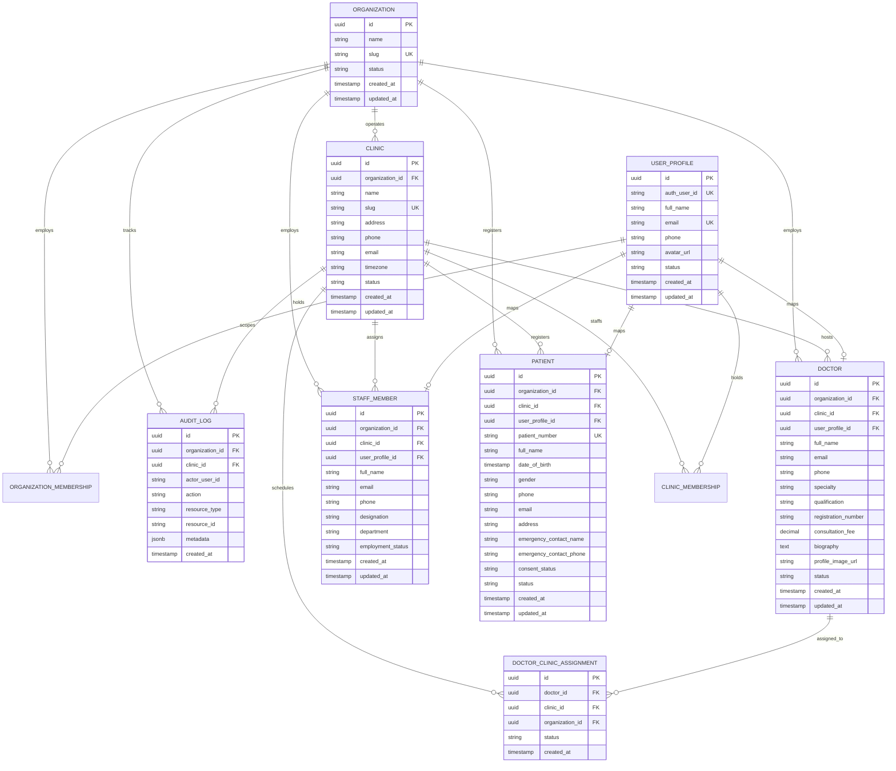

# MatabAI Database Strategy & Schema Reference

Founder: **Muhammad Talha**  
Project: **MatabAI (ShifaDesk)**  
Status: **Phase 3 Complete — Production Clinic, Doctor, Staff & Patient Management Active**

---

## 1. Foundation Overview

MatabAI utilizes PostgreSQL via **Supabase** as its foundational persistence engine, paired with **Prisma ORM** for type-safe queries, connection management, and declarative migrations.

---

## 2. Multi-Tenancy Architecture

MatabAI is a multi-tenant healthcare SaaS where each organization and clinic operates with strict isolation.

### Isolation Strategy: Multi-Tenant Schema with Row-Level Security (RLS)
- Every organizational record references `organization_id` (UUID).
- Clinic-scoped data references `clinic_id` (UUID).
- PostgreSQL Row-Level Security (RLS) policies (`infrastructure/database/rls-policies.sql`) ensure database-level defense in depth for all tables including `doctors`, `doctor_clinic_assignments`, `staff_members`, and `patients`.
- Application-level `TenantGuard` in NestJS verifies that the authenticated user holds an active membership before granting access to tenant resources.
- Indexed foreign keys ensure fast joins and eliminate table scans.

---

## 3. Entity Relationship Diagram (Phase 3 Baseline)

---

## 4. Phase 3 Tables Reference

### 1. `doctors`
Medical consultants, general practitioners, and clinical specialists.
- `id` (UUID, Primary Key)
- `organization_id` (UUID, Foreign Key → `organizations.id`)
- `clinic_id` (UUID, Foreign Key → `clinics.id`)
- `user_profile_id` (UUID, Nullable Foreign Key → `user_profiles.id`)
- `full_name` (String, required)
- `email` (String, nullable)
- `phone` (String, required)
- `specialty` (String, e.g. "Internal Medicine", "Cardiology", "Pediatrics")
- `qualification` (String, e.g. "MBBS, FCPS", "MD, MRCP")
- `registration_number` (String, nullable — **Privacy Rule**: Masked for non-administrative roles)
- `consultation_fee` (Decimal, default 0.00 PKR)
- `biography` (Text, nullable)
- `profile_image_url` (String, nullable)
- `status` (`ACTIVE`, `INACTIVE`)
- `created_at`, `updated_at` (Timestamps)
- *Indexes*: `(organization_id)`, `(clinic_id)`, `(specialty)`

### 2. `doctor_clinic_assignments`
Support for doctors practicing across multiple physical branches.
- `id` (UUID, Primary Key)
- `doctor_id` (UUID, Foreign Key → `doctors.id`)
- `clinic_id` (UUID, Foreign Key → `clinics.id`)
- `organization_id` (UUID, Foreign Key → `organizations.id`)
- `status` (`ACTIVE`, `INACTIVE`)
- `created_at` (Timestamp)
- *Indexes*: Unique on `(doctor_id, clinic_id)`

### 3. `staff_members`
Operational staff including front-desk receptionists, laboratory technicians, nurses, and intake coordinators.
- `id` (UUID, Primary Key)
- `organization_id` (UUID, Foreign Key → `organizations.id`)
- `clinic_id` (UUID, Foreign Key → `clinics.id`)
- `user_profile_id` (UUID, Nullable Foreign Key → `user_profiles.id`)
- `full_name` (String, required)
- `email` (String, required)
- `phone` (String, required)
- `designation` (String, e.g. `RECEPTIONIST`, `LAB_STAFF`, `NURSE`, `ADMIN_ASSISTANT`)
- `department` (String, e.g. "Front Desk / OPD", "Diagnostic Pathology")
- `employment_status` (`ACTIVE`, `INACTIVE`)
- `created_at`, `updated_at` (Timestamps)
- *Indexes*: `(organization_id)`, `(clinic_id)`, `(designation)`

### 4. `patients`
Outpatient demographic records and medical identity.
- `id` (UUID, Primary Key)
- `organization_id` (UUID, Foreign Key → `organizations.id`)
- `clinic_id` (UUID, Foreign Key → `clinics.id`)
- `user_profile_id` (UUID, Nullable Foreign Key → `user_profiles.id`)
- `patient_number` (String, unique, format `MRN-YYYY-XXXX`)
- `full_name` (String, required)
- `date_of_birth` (Timestamp, nullable)
- `gender` (String, nullable)
- `phone` (String, required)
- `email` (String, nullable)
- `address` (String, nullable)
- `emergency_contact_name` (String, nullable)
- `emergency_contact_phone` (String, nullable)
- `consent_status` (`GRANTED`, `REVOKED`)
- `status` (`ACTIVE`, `INACTIVE`)
- `created_at`, `updated_at` (Timestamps)
- *Indexes*: Unique `(organization_id, patient_number)`, and compound `(clinic_id, phone, full_name)` to prevent duplicate outpatient registrations.

---

## 5. Row-Level Security (RLS) Policies

All tables enforce PostgreSQL RLS policies in `infrastructure/database/rls-policies.sql`:
1. **Doctors**: Visible to authenticated organization members; insert/update restricted to tenant `SUPER_ADMIN` and `CLINIC_ADMIN`.
2. **Staff Members**: Visible to authenticated organization members; modification restricted to tenant `SUPER_ADMIN` and `CLINIC_ADMIN`.
3. **Patients**: Visible and manageable by clinic care staff (`SUPER_ADMIN`, `CLINIC_ADMIN`, `DOCTOR`, `RECEPTIONIST`); patients may only query their own mapped record.
4. **Audit Logs**: Strictly append-only. No `UPDATE` or `DELETE` actions are permitted.
