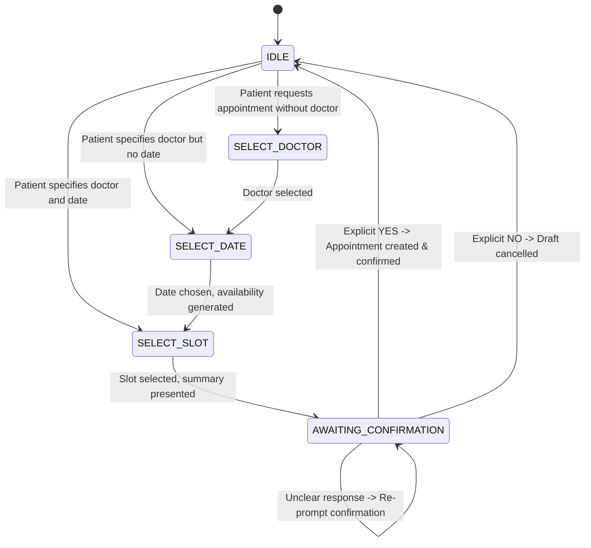

# MatabAI (ShifaDesk) — AI Multilingual Receptionist Architecture

**Founder:** Muhammad Talha  
**Module:** Phase 7 — AI-Powered Multilingual Receptionist  
**Status:** Production Ready  

---

## 1. System Overview

The **ShifaDesk Multilingual AI Receptionist** is an enterprise conversational assistant designed for Pakistani healthcare clinics. It acts as a 24/7 digital front-desk on Meta WhatsApp Cloud API and web channels, handling administrative operations including doctor directory search, real-time availability checks, multi-turn appointment booking, digital token status checks, and clinic FAQ answering.

### Core Non-Negotiable Medical Safety Guardrails
1. **Zero Clinical Advice**: The AI assistant strictly NEVER diagnoses medical conditions, suggests drug dosages, prescribes medicines, interprets laboratory/radiology reports, or recommends clinical treatments.
2. **Immediate Emergency Escalation**: When any life-threatening symptoms (chest pain, heavy bleeding, difficulty breathing, seizures, loss of consciousness) are detected, the assistant immediately issues a localized emergency advisory directing the patient to Rescue 1122 and the nearest hospital emergency room. Conversations are automatically escalated to human staff with `handoverReason: EMERGENCY_OR_URGENT_CONCERN`.
3. **Explicit Confirmation on Appointments**: An appointment is never created or booked without explicit multi-turn confirmation ("YES" / "جی ہاں" / "هو") from the patient.
4. **Sandboxed Tool Invocation**: The LLM never writes direct SQL or raw Prisma queries. All actions execute through 11 allowlisted, schema-validated TypeScript server tools.

---

## 2. Multilingual Natural Language Understanding (NLU)

The NLU engine supports five linguistic modes:
- **English (`en`)**
- **Urdu Nastaliq Script (`ur`)**
- **Pashto Script (`ps`)**
- **Roman Urdu (`ur-Latn`)**
- **Roman Pashto (`ps-Latn`)**

### Language Detection Pipeline
1. **Explicit Language Switch Commands**: (e.g. "Urdu please", "پښتو کې خبرې وکړئ", "switch to English").
2. **Unicode Character Range Analysis**:
   - Pashto specific glyphs (`ۍ`, `ې`, `ږ`, `ښ`, `ځ`, `څ`, `ډ`, `ټ`, `ڼ`) identify Pashto script.
   - Arabic/Urdu Unicode range (`\u0600-\u06FF`) identifies Urdu script.
3. **Romanized Corpus Pattern Matching**:
   - Common Roman Pashto markers (`dera manana`, `staso`, `sangay`, `khair`, `za `, `ghwari`, `jorawil`, `sara `) classify `ps-Latn`.
   - Common Roman Urdu markers (`apka`, `kya`, `hai`, `shukriya`, `dikhana`, `wakt`, `kab`, `batayein`, `mujhe`, `chahiye`, `doctor sahab`) classify `ur-Latn`.

### Intent Classification
The classifier identifies 21 administrative intents:
- `GREETING`
- `CLINIC_INFORMATION`
- `DOCTOR_LOOKUP`
- `SPECIALTY_LOOKUP`
- `WORKING_HOURS`
- `APPOINTMENT_AVAILABILITY`
- `APPOINTMENT_BOOKING`
- `APPOINTMENT_CONFIRMATION`
- `APPOINTMENT_RESCHEDULING`
- `APPOINTMENT_CANCELLATION`
- `TOKEN_LOOKUP`
- `QUEUE_STATUS`
- `LOCATION_INFORMATION`
- `CONTACT_INFORMATION`
- `PRICING_INFORMATION`
- `FAQ`
- `HUMAN_HANDOVER`
- `UNSUPPORTED_REQUEST`
- `MEDICAL_REQUEST` (High priority safety)
- `EMERGENCY_OR_URGENT_CONCERN` (Critical priority safety)
- `UNKNOWN`

---

## 3. The 11 Controlled Allowlisted Tools

Every tool operates in an isolated sandbox, enforces tenant isolation, validates inputs with Zod schemas, and records an execution entry in `ai_tool_execution_logs`:

| # | Tool Name | Description | Required Parameters |
|---|---|---|---|
| 1 | `getClinicInformation` | Returns clinic name, address, contact, and timezone | `clinicId` |
| 2 | `searchDoctors` | Searches active doctors by specialty or name | `clinicId`, optional `specialty`, `doctorName` |
| 3 | `getDoctorAvailability` | Computes live available consultation slots | `clinicId`, `doctorId`, `date` (YYYY-MM-DD) |
| 4 | `createAppointment` | Atomically creates verified appointment record | `clinicId`, `doctorId`, `patientId`, `date`, `startTime`, `endTime` |
| 5 | `getPatientAppointments` | Retrieves upcoming appointments for patient | `patientId`, optional `clinicId` |
| 6 | `rescheduleAppointment` | Atomically moves appointment to new slot | `appointmentId`, `newDate`, `newStartTime`, `newEndTime` |
| 7 | `cancelAppointment` | Cancels appointment with audit reason | `appointmentId`, `reason` |
| 8 | `getPatientToken` | Looks up active token and doctor queue position | `patientId`, optional `clinicId` |
| 9 | `getQueueStatus` | Retrieves real-time queue metrics and current serving token | `clinicId`, optional `doctorId` |
| 10 | `searchClinicFaq` | Retrieves verified clinic FAQ answers | `question`, optional `clinicId`, `language` |
| 11 | `requestHumanHandover` | Escalates conversation to human receptionist | `conversationId`, `reason` |

---

## 4. Multi-Turn Booking Workflow State Machine

---

## 5. Audit Logging & Cost Optimization

Each turn records an `AiInteractionLog`:
- `detectedLanguage`: Captured language code.
- `detectedIntent`: Inferred user intent.
- `provider`: AI Provider used (OpenAI / Groq / Offline rule engine).
- `model`: Model name (e.g., `gpt-4o-mini`).
- `latencyMs`: Round-trip duration in milliseconds.
- `inputTokens` & `outputTokens`: Token usage tally.
- `estimatedCost`: Calculated cost in USD.
- `outcome`: `RESPONDED`, `HANDOVER`, `TOOL_EXECUTED`, or `ERROR`.
