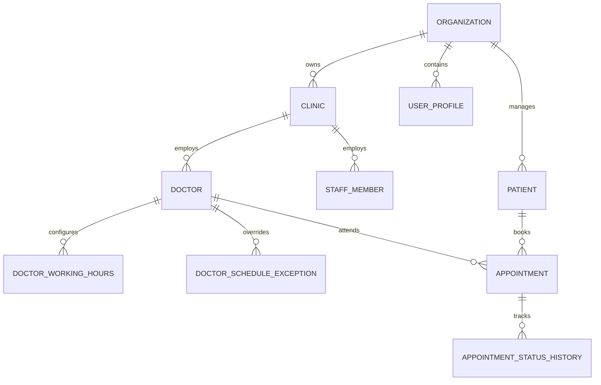

# MatabAI Database Schema & Architecture

## Overview
MatabAI uses PostgreSQL managed through Supabase with Prisma ORM v6. Multi-tenancy is enforced using hierarchical foreign keys (`organization_id`, `clinic_id`) backed by Row-Level Security (RLS) policies and NestJS execution-context guards (`TenantGuard`).

---

## Entity Relationship Overview



---

## Phase 4 Schema: Appointment Scheduling & Booking Engine

### 1. `doctor_working_hours`
Defines recurring weekly availability blocks for doctors at specific clinics.

| Column | Type | Constraints | Description |
| :--- | :--- | :--- | :--- |
| `id` | `UUID` | PK, default `gen_random_uuid()` | Primary Key |
| `organization_id` | `UUID` | FK -> `organizations(id)` | Multi-tenant owner |
| `clinic_id` | `UUID` | FK -> `clinics(id)` | Operating clinic location |
| `doctor_id` | `UUID` | FK -> `doctors(id)` | Attending doctor |
| `day_of_week` | `INT` | 0-6 (0=Sun, 1=Mon, ..., 6=Sat) | Day of week |
| `start_time` | `VARCHAR(5)` | `HH:mm` format | Shift start time |
| `end_time` | `VARCHAR(5)` | `HH:mm` format | Shift end time (must be > `start_time`) |
| `slot_duration_minutes` | `INT` | > 0 (e.g. 15, 20, 30, 45, 60) | Duration per appointment slot |
| `break_start_time` | `VARCHAR(5)` | Nullable, `HH:mm` format | Break/lunch start time |
| `break_end_time` | `VARCHAR(5)` | Nullable, `HH:mm` format | Break/lunch end time (must be > `break_start_time`) |
| `effective_from` | `TIMESTAMPTZ` | NOT NULL | Date rule becomes effective |
| `effective_until` | `TIMESTAMPTZ` | Nullable | Optional expiration date |
| `is_active` | `BOOLEAN` | Default `true` | Active status toggle |
| `created_at` | `TIMESTAMPTZ` | Default `now()` | Record creation timestamp |
| `updated_at` | `TIMESTAMPTZ` | Updated on change | Record update timestamp |

**Business Constraints:**
- Overlapping active working periods for the same `doctor_id`, `clinic_id`, and `day_of_week` are prohibited server-side.
- Break intervals must be strictly contained within `[start_time, end_time]`.

---

### 2. `doctor_schedule_exceptions`
Captures dates where standard working hours do not apply (holidays, personal leave, or custom modified hours).

| Column | Type | Constraints | Description |
| :--- | :--- | :--- | :--- |
| `id` | `UUID` | PK, default `gen_random_uuid()` | Primary Key |
| `organization_id` | `UUID` | FK -> `organizations(id)` | Multi-tenant owner |
| `clinic_id` | `UUID` | FK -> `clinics(id)` | Operating clinic location |
| `doctor_id` | `UUID` | FK -> `doctors(id)` | Doctor with override |
| `exception_date` | `DATE` | NOT NULL | YYYY-MM-DD date |
| `exception_type` | `VARCHAR(20)` | `UNAVAILABLE` \| `CUSTOM_HOURS` | Exception behavior |
| `start_time` | `VARCHAR(5)` | Nullable, required for `CUSTOM_HOURS` | Override start time |
| `end_time` | `VARCHAR(5)` | Nullable, required for `CUSTOM_HOURS` | Override end time |
| `reason` | `TEXT` | Nullable | Reason (e.g. National Holiday, Medical Leave) |
| `created_at` | `TIMESTAMPTZ` | Default `now()` | Record creation timestamp |
| `updated_at` | `TIMESTAMPTZ` | Updated on change | Record update timestamp |

**Business Constraints:**
- Unique compound constraint `[doctor_id, clinic_id, exception_date]` prevents conflicting duplicate overrides for the same date.
- `CUSTOM_HOURS` requires both `start_time` and `end_time` where `start_time < end_time`.

---

### 3. `appointments`
Tracks outpatient bookings, scheduled timings, booking source, and lifecycle states.

| Column | Type | Constraints | Description |
| :--- | :--- | :--- | :--- |
| `id` | `UUID` | PK, default `gen_random_uuid()` | Primary Key |
| `organization_id` | `UUID` | FK -> `organizations(id)` | Multi-tenant owner |
| `clinic_id` | `UUID` | FK -> `clinics(id)` | Operating clinic location |
| `doctor_id` | `UUID` | FK -> `doctors(id)` | Attending doctor |
| `patient_id` | `UUID` | FK -> `patients(id)` | Booked patient |
| `appointment_number` | `VARCHAR(32)` | UNIQUE, NOT NULL | Deterministic identifier `APT-YYYY-XXXX` |
| `appointment_date` | `DATE` | NOT NULL | Scheduled appointment date |
| `start_time` | `VARCHAR(5)` | NOT NULL, `HH:mm` format | Slot start time |
| `end_time` | `VARCHAR(5)` | NOT NULL, `HH:mm` format | Slot end time |
| `timezone` | `VARCHAR(64)` | Default `Asia/Karachi` | Clinic timezone |
| `status` | `VARCHAR(20)` | `PENDING`, `CONFIRMED`, `CANCELLED`, `COMPLETED`, `NO_SHOW`, `IN_PROGRESS` | Lifecycle state |
| `booking_source` | `VARCHAR(20)` | `MANUAL`, `ONLINE`, `WHATSAPP`, `VOICE_AI`, `WALK_IN` | Ingestion channel |
| `reason_for_visit` | `TEXT` | Nullable | Patient's primary complaint |
| `internal_notes` | `TEXT` | Nullable | Staff/reception internal notes |
| `cancellation_reason` | `TEXT` | Nullable | Required on cancellation |
| `created_by` | `UUID` | NOT NULL | User who booked |
| `cancelled_by` | `UUID` | Nullable | User who cancelled |
| `rescheduled_from_id` | `UUID` | Nullable, FK -> `appointments(id)` | Audit trail of previous appointment |
| `created_at` | `TIMESTAMPTZ` | Default `now()` | Record creation timestamp |
| `updated_at` | `TIMESTAMPTZ` | Updated on change | Record update timestamp |

**Concurrency & Anti-Conflict Rules:**
- Server-side database transactions verify slot availability before booking or rescheduling.
- Overlap criteria: For the same `doctor_id`, `clinic_id`, and `appointment_date`, no active appointment (status != `CANCELLED`) may overlap `[start_time, end_time)`.
- If an overlap is detected, the transaction immediately rolls back and returns `409 ConflictException`.
- Appointments are never hard deleted; cancellations transition status to `CANCELLED`, record reason and actor, and release the slot for future bookings.

---

### 4. `appointment_status_history`
Append-only audit trail capturing every state change throughout an appointment's lifecycle.

| Column | Type | Constraints | Description |
| :--- | :--- | :--- | :--- |
| `id` | `UUID` | PK, default `gen_random_uuid()` | Primary Key |
| `appointment_id` | `UUID` | FK -> `appointments(id)` | Target appointment |
| `organization_id` | `UUID` | FK -> `organizations(id)` | Multi-tenant owner |
| `clinic_id` | `UUID` | FK -> `clinics(id)` | Clinic location |
| `previous_status` | `VARCHAR(20)` | Nullable (null on creation) | Previous state |
| `new_status` | `VARCHAR(20)` | NOT NULL | Transitioned state |
| `changed_by` | `UUID` | NOT NULL | User ID who performed transition |
| `change_reason` | `TEXT` | Nullable | Optional note or mandatory cancellation reason |
| `created_at` | `TIMESTAMPTZ` | Default `now()` | Audit record timestamp |

---

## Row-Level Security (RLS) Policies

All Phase 4 tables are protected by Postgres RLS:
```sql
ALTER TABLE doctor_working_hours ENABLE ROW LEVEL SECURITY;
ALTER TABLE doctor_schedule_exceptions ENABLE ROW LEVEL SECURITY;
ALTER TABLE appointments ENABLE ROW LEVEL SECURITY;
ALTER TABLE appointment_status_history ENABLE ROW LEVEL SECURITY;
```
RLS enforces that tenants can only read and write rows where `organization_id` matches their authenticated session context `auth.jwt() ->> 'organization_id'`.
