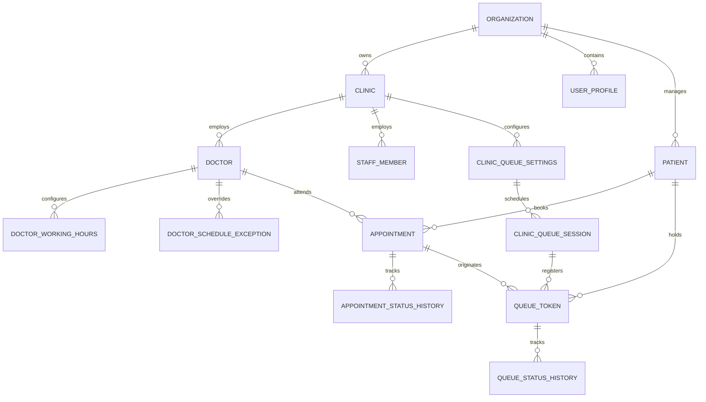

# MatabAI Database Schema & Architecture

## Overview
MatabAI uses PostgreSQL managed through Supabase with Prisma ORM v6. Multi-tenancy is enforced using hierarchical foreign keys (`organization_id`, `clinic_id`) backed by Row-Level Security (RLS) policies and NestJS execution-context guards (`TenantGuard`).

---

## Entity Relationship Overview



---

## Phase 4 Schema: Appointment Scheduling & Booking Engine

### 1. `doctor_working_hours`
Defines recurring weekly availability blocks for doctors at specific clinics.

| Column | Type | Constraints | Description |
| :--- | :--- | :--- | :--- |
| `id` | `UUID` | PK, default `gen_random_uuid()` | Primary Key |
| `organization_id` | `UUID` | FK -> `organizations(id)` | Multi-tenant owner |
| `clinic_id` | `UUID` | FK -> `clinics(id)` | Operating clinic location |
| `doctor_id` | `UUID` | FK -> `doctors(id)` | Attending doctor |
| `day_of_week` | `INT` | 0-6 (0=Sun, 1=Mon, ..., 6=Sat) | Day of week |
| `start_time` | `VARCHAR(5)` | `HH:mm` format | Shift start time |
| `end_time` | `VARCHAR(5)` | `HH:mm` format | Shift end time (must be > `start_time`) |
| `slot_duration_minutes` | `INT` | > 0 (e.g. 15, 20, 30, 45, 60) | Duration per appointment slot |
| `break_start_time` | `VARCHAR(5)` | Nullable, `HH:mm` format | Break/lunch start time |
| `break_end_time` | `VARCHAR(5)` | Nullable, `HH:mm` format | Break/lunch end time (must be > `break_start_time`) |
| `effective_from` | `TIMESTAMPTZ` | NOT NULL | Date rule becomes effective |
| `effective_until` | `TIMESTAMPTZ` | Nullable | Optional expiration date |
| `is_active` | `BOOLEAN` | Default `true` | Active status toggle |
| `created_at` | `TIMESTAMPTZ` | Default `now()` | Record creation timestamp |
| `updated_at` | `TIMESTAMPTZ` | Updated on change | Record update timestamp |

**Business Constraints:**
- Overlapping active working periods for the same `doctor_id`, `clinic_id`, and `day_of_week` are prohibited server-side.
- Break intervals must be strictly contained within `[start_time, end_time]`.

---

### 2. `doctor_schedule_exceptions`
Captures dates where standard working hours do not apply (holidays, personal leave, or custom modified hours).

| Column | Type | Constraints | Description |
| :--- | :--- | :--- | :--- |
| `id` | `UUID` | PK, default `gen_random_uuid()` | Primary Key |
| `organization_id` | `UUID` | FK -> `organizations(id)` | Multi-tenant owner |
| `clinic_id` | `UUID` | FK -> `clinics(id)` | Operating clinic location |
| `doctor_id` | `UUID` | FK -> `doctors(id)` | Doctor with override |
| `exception_date` | `DATE` | NOT NULL | YYYY-MM-DD date |
| `exception_type` | `VARCHAR(20)` | `UNAVAILABLE` \| `CUSTOM_HOURS` | Exception behavior |
| `start_time` | `VARCHAR(5)` | Nullable, required for `CUSTOM_HOURS` | Override start time |
| `end_time` | `VARCHAR(5)` | Nullable, required for `CUSTOM_HOURS` | Override end time |
| `reason` | `TEXT` | Nullable | Reason (e.g. National Holiday, Medical Leave) |
| `created_at` | `TIMESTAMPTZ` | Default `now()` | Record creation timestamp |
| `updated_at` | `TIMESTAMPTZ` | Updated on change | Record update timestamp |

---

### 3. `appointments`
Tracks outpatient bookings, scheduled timings, booking source, and lifecycle states.

| Column | Type | Constraints | Description |
| :--- | :--- | :--- | :--- |
| `id` | `UUID` | PK, default `gen_random_uuid()` | Primary Key |
| `organization_id` | `UUID` | FK -> `organizations(id)` | Multi-tenant owner |
| `clinic_id` | `UUID` | FK -> `clinics(id)` | Operating clinic location |
| `doctor_id` | `UUID` | FK -> `doctors(id)` | Attending doctor |
| `patient_id` | `UUID` | FK -> `patients(id)` | Booked patient |
| `appointment_number` | `VARCHAR(32)` | UNIQUE, NOT NULL | Deterministic identifier `APT-YYYY-XXXX` |
| `appointment_date` | `DATE` | NOT NULL | Scheduled appointment date |
| `start_time` | `VARCHAR(5)` | NOT NULL, `HH:mm` format | Slot start time |
| `end_time` | `VARCHAR(5)` | NOT NULL, `HH:mm` format | Slot end time |
| `timezone` | `VARCHAR(64)` | Default `Asia/Karachi` | Clinic timezone |
| `status` | `VARCHAR(20)` | `PENDING`, `CONFIRMED`, `CANCELLED`, `COMPLETED`, `NO_SHOW`, `IN_PROGRESS` | Lifecycle state |
| `booking_source` | `VARCHAR(20)` | `MANUAL`, `ONLINE`, `WHATSAPP`, `VOICE_AI`, `WALK_IN` | Ingestion channel |
| `reason_for_visit` | `TEXT` | Nullable | Patient's primary complaint |
| `internal_notes` | `TEXT` | Nullable | Staff/reception internal notes |
| `cancellation_reason` | `TEXT` | Nullable | Required on cancellation |
| `created_by` | `UUID` | NOT NULL | User who booked |
| `cancelled_by` | `UUID` | Nullable | User who cancelled |
| `rescheduled_from_id` | `UUID` | Nullable, FK -> `appointments(id)` | Audit trail of previous appointment |
| `created_at` | `TIMESTAMPTZ` | Default `now()` | Record creation timestamp |
| `updated_at` | `TIMESTAMPTZ` | Updated on change | Record update timestamp |

---

### 4. `appointment_status_history`
Append-only audit trail capturing every state change throughout an appointment's lifecycle.

| Column | Type | Constraints | Description |
| :--- | :--- | :--- | :--- |
| `id` | `UUID` | PK, default `gen_random_uuid()` | Primary Key |
| `appointment_id` | `UUID` | FK -> `appointments(id)` | Target appointment |
| `organization_id` | `UUID` | FK -> `organizations(id)` | Multi-tenant owner |
| `clinic_id` | `UUID` | FK -> `clinics(id)` | Clinic location |
| `previous_status` | `VARCHAR(20)` | Nullable | Previous state |
| `new_status` | `VARCHAR(20)` | NOT NULL | Transitioned state |
| `changed_by` | `UUID` | NOT NULL | User ID who performed transition |
| `change_reason` | `TEXT` | Nullable | Reason note |
| `created_at` | `TIMESTAMPTZ` | Default `now()` | Audit record timestamp |

---

## Phase 5 Schema: Digital Token & Real-Time Queue Management

### 1. `clinic_queue_settings`
Configures operational queue parameters for specific clinic branches or doctor consultation rooms.

| Column | Type | Constraints | Description |
| :--- | :--- | :--- | :--- |
| `id` | `UUID` | PK, default `gen_random_uuid()` | Primary Key |
| `organization_id` | `UUID` | FK -> `organizations(id)` | Multi-tenant owner |
| `clinic_id` | `UUID` | FK -> `clinics(id)` | Operating clinic location |
| `doctor_id` | `UUID` | Nullable, FK -> `doctors(id)` | Optional doctor-dedicated queue |
| `queue_name` | `VARCHAR(100)` | NOT NULL | Queue display name (e.g. "General OPD") |
| `token_prefix` | `VARCHAR(5)` | Default `'A'` | Prefix character (e.g. A, B, OPD) |
| `token_reset_policy` | `VARCHAR(20)` | Default `'DAILY'` | Token reset rule |
| `allow_walk_ins` | `BOOLEAN` | Default `true` | Enables walk-in check-in |
| `allow_appointment_check_in`| `BOOLEAN` | Default `true` | Enables appointment check-in |
| `estimated_consultation_minutes` | `INT` | Default `15` | Average consultation duration |
| `max_queue_capacity` | `INT` | Nullable | Max tokens permitted per day |
| `public_queue_id` | `VARCHAR(64)` | UNIQUE, default UUID | High-entropy revocable public identifier |
| `is_public_display_enabled` | `BOOLEAN` | Default `true` | Public display monitor toggle |
| `is_active` | `BOOLEAN` | Default `true` | Queue active status |
| `created_at` | `TIMESTAMPTZ` | Default `now()` | Timestamp |
| `updated_at` | `TIMESTAMPTZ` | Updated on change | Timestamp |

---

### 2. `clinic_queue_sessions`
Captures daily operational queue sessions. Each session represents one queue instance on a clinic-local date.

| Column | Type | Constraints | Description |
| :--- | :--- | :--- | :--- |
| `id` | `UUID` | PK, default `gen_random_uuid()` | Primary Key |
| `organization_id` | `UUID` | FK -> `organizations(id)` | Multi-tenant owner |
| `clinic_id` | `UUID` | FK -> `clinics(id)` | Operating clinic location |
| `doctor_id` | `UUID` | Nullable, FK -> `doctors(id)` | Attending doctor |
| `queue_settings_id` | `UUID` | FK -> `clinic_queue_settings(id)`| Configuration reference |
| `session_date` | `VARCHAR(10)` | YYYY-MM-DD in clinic timezone | Session calendar day |
| `status` | `VARCHAR(20)` | `NOT_STARTED`, `ACTIVE`, `PAUSED`, `CLOSED` | Operational state |
| `last_token_number` | `INT` | Default `0` | Sequential counter |
| `current_token_number` | `INT` | Nullable | Active token called |
| `total_registered` | `INT` | Default `0` | Total tokens issued today |
| `total_completed` | `INT` | Default `0` | Total consultations finished |
| `started_at` | `TIMESTAMPTZ` | Nullable | Opening timestamp |
| `closed_at` | `TIMESTAMPTZ` | Nullable | Closing timestamp |
| `created_at` | `TIMESTAMPTZ` | Default `now()` | Timestamp |
| `updated_at` | `TIMESTAMPTZ` | Updated on change | Timestamp |

**Uniqueness & Integrity:**
- Unique compound constraint `[queue_settings_id, session_date]` ensures exactly one session exists per queue per day.
- A closed session cannot accept check-ins or issue new tokens.
- Closing a session while a patient is in `SERVING` status requires explicit administrative confirmation.

---

### 3. `queue_tokens`
Represents outpatient digital queue tokens issued to patients.

| Column | Type | Constraints | Description |
| :--- | :--- | :--- | :--- |
| `id` | `UUID` | PK, default `gen_random_uuid()` | Primary Key |
| `organization_id` | `UUID` | FK -> `organizations(id)` | Multi-tenant owner |
| `clinic_id` | `UUID` | FK -> `clinics(id)` | Operating clinic location |
| `queue_session_id` | `UUID` | FK -> `clinic_queue_sessions(id)`| Associated session |
| `appointment_id` | `UUID` | Nullable, FK -> `appointments(id)` | Linked appointment |
| `patient_id` | `UUID` | FK -> `patients(id)` | Patient recipient |
| `token_number` | `INT` | Sequential per session | Daily numeric token number |
| `token_display` | `VARCHAR(16)` | E.g. `A001`, `A002` | Formatted display token |
| `queue_position` | `INT` | Default `0` | Current 1-based waiting position |
| `status` | `VARCHAR(20)` | `WAITING`, `CALLED`, `SERVING`, `COMPLETED`, `SKIPPED`, `CANCELLED`, `NO_SHOW` | Token lifecycle |
| `priority_type` | `VARCHAR(20)` | `NORMAL`, `PRIORITY` | Triage priority |
| `checked_in_at` | `TIMESTAMPTZ` | Default `now()` | Arrival time |
| `called_at` | `TIMESTAMPTZ` | Nullable | When token was called |
| `service_started_at`| `TIMESTAMPTZ` | Nullable | Consultation start time |
| `completed_at` | `TIMESTAMPTZ` | Nullable | Consultation completion |
| `skipped_at` | `TIMESTAMPTZ` | Nullable | When patient was skipped |
| `cancelled_at` | `TIMESTAMPTZ` | Nullable | When token was cancelled |
| `estimated_wait_minutes` | `INT` | Nullable | Dynamic wait estimate |
| `notes` | `TEXT` | Nullable | Intake or triage notes |
| `created_at` | `TIMESTAMPTZ` | Default `now()` | Timestamp |
| `updated_at` | `TIMESTAMPTZ` | Updated on change | Timestamp |

**Concurrency & Anti-Duplicate Rules:**
- Compound unique index `[queue_session_id, token_number]`.
- Token numbers are atomically generated via interactive transaction `$transaction` reading and incrementing `last_token_number`.
- An appointment cannot receive duplicate active tokens.
- A patient cannot hold duplicate active tokens in the same queue session.

---

### 4. `queue_status_history`
Append-only audit trail capturing all token state transitions.

| Column | Type | Constraints | Description |
| :--- | :--- | :--- | :--- |
| `id` | `UUID` | PK, default `gen_random_uuid()` | Primary Key |
| `organization_id` | `UUID` | FK -> `organizations(id)` | Multi-tenant owner |
| `clinic_id` | `UUID` | FK -> `clinics(id)` | Clinic location |
| `queue_token_id` | `UUID` | FK -> `queue_tokens(id)` | Target token |
| `previous_status` | `VARCHAR(20)` | Nullable | Previous state |
| `new_status` | `VARCHAR(20)` | NOT NULL | Transitioned state |
| `changed_by` | `UUID` | NOT NULL | User ID who performed transition |
| `change_reason` | `TEXT` | Nullable | Transition reason |
| `created_at` | `TIMESTAMPTZ` | Default `now()` | Timestamp |

---

## Token Ordering & Wait-Time Algorithm

### Queue Ordering Logic
1. **Priority Tokens First:** Tokens flagged with `priority_type = PRIORITY` (elderly, pediatric, urgent triage).
2. **First-In First-Out (FIFO):** Within each priority level, ordered by `checked_in_at ASC`.
3. **Deterministic Tie-Breaker:** Ordered by `token_number ASC`.

### Estimated Waiting Time Formula
$$\text{Estimated Wait} = (\text{Queue Position} - 1) \times \text{Estimated Consultation Minutes}$$

When queue state transitions occur (`CALL_NEXT`, `SKIP`, `RESTORE`, `CANCEL`), positions and estimated wait times are automatically recalculated across all remaining waiting tokens.

---

## Row-Level Security (RLS) Policies

All Phase 4 & Phase 5 tables are protected by Postgres RLS:
```sql
ALTER TABLE clinic_queue_settings ENABLE ROW LEVEL SECURITY;
ALTER TABLE clinic_queue_sessions ENABLE ROW LEVEL SECURITY;
ALTER TABLE queue_tokens ENABLE ROW LEVEL SECURITY;
ALTER TABLE queue_status_history ENABLE ROW LEVEL SECURITY;
```
- Staff can only access queues within their assigned organization.
- Patients can only view their own tokens (`patient_id = current_user_patient_id`).
- Public waiting room displays access only minimal sanitized data via high-entropy `public_queue_id` without exposing private patient records.

---

# Phase 6: WhatsApp Business Cloud API Integration Schema

## 1. `whatsapp_integrations`
Stores Meta WhatsApp Business Account (WABA) credentials and webhook configuration per clinic branch.

| Column | Type | Constraints | Description |
| :--- | :--- | :--- | :--- |
| `id` | `UUID` | PK, default `gen_random_uuid()` | Primary Key |
| `organization_id` | `UUID` | FK -> `organizations(id)` | Multi-tenant boundary |
| `clinic_id` | `UUID` | Unique, FK -> `clinics(id)` | Clinic branch |
| `phone_number_id` | `VARCHAR(50)` | Unique, NOT NULL | Meta Phone Number ID |
| `waba_id` | `VARCHAR(50)` | NOT NULL | WhatsApp Business Account ID |
| `business_phone_number` | `VARCHAR(20)` | NOT NULL | Normalized E.164 phone |
| `display_name` | `VARCHAR(100)` | Nullable | Verified display name |
| `access_token_encrypted` | `TEXT` | NOT NULL | AES-256 encrypted permanent token |
| `webhook_verify_token` | `VARCHAR(128)` | NOT NULL | Handshake verification token |
| `status` | `VARCHAR(20)` | Default `PENDING` | `PENDING`, `CONNECTED`, `DISCONNECTED`, `ERROR` |
| `is_webhook_verified` | `BOOLEAN` | Default `false` | Webhook verification status |
| `last_connected_at` | `TIMESTAMPTZ` | Nullable | Last successful ping / webhook |
| `metadata` | `JSONB` | Nullable | Phone number quality, display details |
| `created_at` | `TIMESTAMPTZ` | Default `now()` | Timestamp |
| `updated_at` | `TIMESTAMPTZ` | Updated on change | Timestamp |

## 2. `whatsapp_contacts`
Patient subscribers, E.164 phone mapping, and explicit opt-in / opt-out consent tracking.

| Column | Type | Constraints | Description |
| :--- | :--- | :--- | :--- |
| `id` | `UUID` | PK, default `gen_random_uuid()` | Primary Key |
| `organization_id` | `UUID` | FK -> `organizations(id)` | Multi-tenant boundary |
| `clinic_id` | `UUID` | FK -> `clinics(id)` | Clinic branch |
| `patient_id` | `UUID` | Nullable, FK -> `patients(id)` | Linked outpatient record |
| `wa_id` | `VARCHAR(20)` | NOT NULL | E.164 normalized digits (no +) |
| `profile_name` | `VARCHAR(100)` | Nullable | WhatsApp profile display name |
| `consent_status` | `VARCHAR(20)` | Default `UNKNOWN` | `UNKNOWN`, `OPTED_IN`, `OPTED_OUT` |
| `consent_updated_at` | `TIMESTAMPTZ` | Nullable | When opt-in/opt-out changed |
| `opt_out_reason` | `TEXT` | Nullable | Keyword / staff reason |
| `last_inbound_at` | `TIMESTAMPTZ` | Nullable | Last inbound message timestamp |
| `last_outbound_at` | `TIMESTAMPTZ` | Nullable | Last outbound message timestamp |
| `created_at` | `TIMESTAMPTZ` | Default `now()` | Timestamp |
| `updated_at` | `TIMESTAMPTZ` | Updated on change | Timestamp |

Unique Constraint: `[clinic_id, wa_id]`.

## 3. `whatsapp_conversations`
Active conversation sessions, 24-hour customer service window tracking, and receptionist human handover.

| Column | Type | Constraints | Description |
| :--- | :--- | :--- | :--- |
| `id` | `UUID` | PK, default `gen_random_uuid()` | Primary Key |
| `organization_id` | `UUID` | FK -> `organizations(id)` | Multi-tenant boundary |
| `clinic_id` | `UUID` | FK -> `clinics(id)` | Clinic branch |
| `contact_id` | `UUID` | FK -> `whatsapp_contacts(id)` | Subscriber contact |
| `assigned_user_id` | `UUID` | Nullable, FK -> `user_profiles(id)` | Claiming staff receptionist |
| `status` | `VARCHAR(20)` | Default `OPEN` | `OPEN`, `HUMAN_HANDOVER`, `RESOLVED`, `CLOSED` |
| `handover_reason` | `TEXT` | Nullable | Triage keyword or receptionist note |
| `handover_at` | `TIMESTAMPTZ` | Nullable | Timestamp when handover requested |
| `resolved_at` | `TIMESTAMPTZ` | Nullable | Timestamp when marked resolved |
| `last_customer_message_at` | `TIMESTAMPTZ` | Nullable | Customer inbound timestamp for 24-hr window calculation |
| `last_message_preview` | `VARCHAR(255)` | Nullable | Preview of last message |
| `unread_count` | `INT` | Default `0` | Unread incoming messages |
| `created_at` | `TIMESTAMPTZ` | Default `now()` | Timestamp |
| `updated_at` | `TIMESTAMPTZ` | Updated on change | Timestamp |

## 4. `whatsapp_messages`
Inbound and outbound message ledger with provider tracking and delivery statuses.

| Column | Type | Constraints | Description |
| :--- | :--- | :--- | :--- |
| `id` | `UUID` | PK, default `gen_random_uuid()` | Primary Key |
| `organization_id` | `UUID` | FK -> `organizations(id)` | Multi-tenant boundary |
| `clinic_id` | `UUID` | FK -> `clinics(id)` | Clinic branch |
| `conversation_id` | `UUID` | FK -> `whatsapp_conversations(id)` | Thread session |
| `contact_id` | `UUID` | FK -> `whatsapp_contacts(id)` | Contact record |
| `provider_message_id` | `VARCHAR(100)` | Unique, Nullable | Meta `wamid.HBgL...` |
| `direction` | `VARCHAR(10)` | NOT NULL | `INBOUND`, `OUTBOUND` |
| `message_type` | `VARCHAR(20)` | Default `text` | `text`, `template`, `interactive`, etc. |
| `body` | `TEXT` | Nullable | Message body text or caption |
| `raw_payload` | `JSONB` | Nullable | Full Meta JSON webhook payload |
| `template_name` | `VARCHAR(100)` | Nullable | Approved template identifier |
| `template_params` | `JSONB` | Nullable | Dynamic parameter substitutions |
| `status` | `VARCHAR(20)` | Default `RECEIVED` | `RECEIVED`, `QUEUED`, `SENT`, `DELIVERED`, `READ`, `FAILED` |
| `error_code` | `VARCHAR(50)` | Nullable | Meta error code |
| `error_message` | `TEXT` | Nullable | Sanitized error description |
| `sent_at` | `TIMESTAMPTZ` | Nullable | Outbound dispatch timestamp |
| `delivered_at` | `TIMESTAMPTZ` | Nullable | Delivery receipt timestamp |
| `read_at` | `TIMESTAMPTZ` | Nullable | Read receipt timestamp |
| `created_at` | `TIMESTAMPTZ` | Default `now()` | Timestamp |
| `updated_at` | `TIMESTAMPTZ` | Updated on change | Timestamp |

## 5. `whatsapp_webhook_events`
Deduplication ledger ensuring idempotent webhook processing.

| Column | Type | Constraints | Description |
| :--- | :--- | :--- | :--- |
| `id` | `UUID` | PK, default `gen_random_uuid()` | Primary Key |
| `event_id` | `VARCHAR(128)` | Unique, NOT NULL | Deduplication key |
| `event_type` | `VARCHAR(50)` | NOT NULL | `messages`, `statuses` |
| `payload` | `JSONB` | NOT NULL | Webhook event payload |
| `processing_status` | `VARCHAR(20)` | Default `RECEIVED` | `RECEIVED`, `PROCESSING`, `PROCESSED`, `FAILED` |
| `processed_at` | `TIMESTAMPTZ` | Nullable | Completion timestamp |
| `error_message` | `TEXT` | Nullable | Failure reason if failed |
| `created_at` | `TIMESTAMPTZ` | Default `now()` | Ingestion timestamp |

## 6. `whatsapp_message_templates`
Registered pre-approved Meta WhatsApp templates for notifications outside the 24-hour customer window.

| Column | Type | Constraints | Description |
| :--- | :--- | :--- | :--- |
| `id` | `UUID` | PK, default `gen_random_uuid()` | Primary Key |
| `organization_id` | `UUID` | FK -> `organizations(id)` | Multi-tenant boundary |
| `clinic_id` | `UUID` | FK -> `clinics(id)` | Clinic branch |
| `integration_id` | `UUID` | Nullable, FK -> `whatsapp_integrations(id)` | Linked Meta integration |
| `name` | `VARCHAR(100)` | NOT NULL | Template name e.g. `appointment_confirmation` |
| `language` | `VARCHAR(10)` | Default `en_US` | Language code |
| `category` | `VARCHAR(30)` | Default `UTILITY` | `UTILITY`, `MARKETING`, `AUTHENTICATION` |
| `status` | `VARCHAR(20)` | Default `APPROVED` | `PENDING`, `APPROVED`, `REJECTED`, `PAUSED` |
| `header_format` | `VARCHAR(20)` | Nullable | `TEXT`, `IMAGE`, `DOCUMENT` |
| `body_template` | `TEXT` | NOT NULL | Body with `{{1}}`, `{{2}}` placeholders |
| `footer_template` | `TEXT` | Nullable | Footer disclaimer text |
| `parameter_names` | `TEXT[]` | Default `{}` | Semantic placeholder names |
| `created_at` | `TIMESTAMPTZ` | Default `now()` | Timestamp |
| `updated_at` | `TIMESTAMPTZ` | Updated on change | Timestamp |

Unique Constraint: `[clinic_id, name, language]`.

---

# Phase 7: AI-Powered Multilingual Receptionist Schema

## 1. `ai_assistant_settings`
Configuration and capability permissions for the AI virtual assistant per clinic branch.

| Column | Type | Constraints | Description |
| :--- | :--- | :--- | :--- |
| `id` | `UUID` | PK, default `gen_random_uuid()` | Primary Key |
| `organization_id` | `UUID` | FK -> `organizations(id)` | Multi-tenant boundary |
| `clinic_id` | `UUID` | Unique, FK -> `clinics(id)` | Clinic branch |
| `assistant_name` | `VARCHAR(100)` | Default `'ShifaDesk Assistant'` | Assistant persona name |
| `enabled` | `BOOLEAN` | Default `true` | Master active/paused switch |
| `default_language` | `VARCHAR(10)` | Default `'EN'` | Default initial language (`EN`, `UR`, `PS`) |
| `supported_languages` | `TEXT[]` | Default `{'EN', 'UR', 'PS'}` | Supported languages array |
| `greeting_message` | `TEXT` | NOT NULL | Greeting message template |
| `fallback_message` | `TEXT` | NOT NULL | Fallback message template |
| `human_handover_enabled` | `BOOLEAN` | Default `true` | Auto-escalation flag |
| `appointment_booking_enabled` | `BOOLEAN` | Default `true` | Booking engine permission |
| `token_lookup_enabled` | `BOOLEAN` | Default `true` | Queue token lookup permission |
| `clinic_faq_enabled` | `BOOLEAN` | Default `true` | FAQ search permission |
| `max_turns_per_conversation` | `INT` | Default `20` | Max turns before handover |
| `created_at` | `TIMESTAMPTZ` | Default `now()` | Timestamp |
| `updated_at` | `TIMESTAMPTZ` | Updated on change | Timestamp |

## 2. `ai_conversation_states`
Multi-turn conversational context, active workflow step, and extracted entities for live patient conversations.

| Column | Type | Constraints | Description |
| :--- | :--- | :--- | :--- |
| `id` | `UUID` | PK, default `gen_random_uuid()` | Primary Key |
| `organization_id` | `UUID` | FK -> `organizations(id)` | Multi-tenant boundary |
| `clinic_id` | `UUID` | Nullable, FK -> `clinics(id)` | Clinic branch |
| `conversation_id` | `UUID` | Unique, FK -> `whatsapp_conversations(id)` | Linked conversation |
| `detected_language` | `VARCHAR(20)` | Default `'en'` | Active language (`en`, `ur`, `ps`, `ur-Latn`, `ps-Latn`) |
| `current_intent` | `VARCHAR(50)` | Nullable | Last detected intent |
| `current_step` | `VARCHAR(50)` | Nullable | Active multi-turn step |
| `conversation_context` | `JSONB` | Default `'{}'` | Extracted doctorId, date, time, draft details |
| `handover_required` | `BOOLEAN` | Default `false` | Human escalation flag |
| `last_processed_message_id` | `VARCHAR(128)` | Nullable | Provider message ID |
| `last_activity_at` | `TIMESTAMPTZ` | Default `now()` | Last turn timestamp |
| `created_at` | `TIMESTAMPTZ` | Default `now()` | Timestamp |
| `updated_at` | `TIMESTAMPTZ` | Updated on change | Timestamp |

## 3. `ai_interaction_logs`
Detailed audit ledger of every conversational turn, token usage, latency, and estimated cost.

| Column | Type | Constraints | Description |
| :--- | :--- | :--- | :--- |
| `id` | `UUID` | PK, default `gen_random_uuid()` | Primary Key |
| `organization_id` | `UUID` | FK -> `organizations(id)` | Multi-tenant boundary |
| `clinic_id` | `UUID` | Nullable, FK -> `clinics(id)` | Clinic branch |
| `conversation_id` | `UUID` | FK -> `whatsapp_conversations(id)` | Linked conversation |
| `inbound_message_id` | `VARCHAR(128)` | Nullable | Inbound message ID |
| `detected_language` | `VARCHAR(20)` | NOT NULL | Detected language |
| `detected_intent` | `VARCHAR(50)` | NOT NULL | Classified intent |
| `provider` | `VARCHAR(50)` | NOT NULL | AI provider (`openai`, `groq`, `offline`) |
| `model` | `VARCHAR(50)` | NOT NULL | Model identifier |
| `tool_calls` | `JSONB` | Nullable | Tool invocation metadata |
| `outcome` | `VARCHAR(50)` | NOT NULL | `RESPONDED`, `HANDOVER`, `TOOL_EXECUTED`, `ERROR` |
| `latency_ms` | `INT` | NOT NULL | Processing duration in ms |
| `input_tokens` | `INT` | Nullable | Prompt token count |
| `output_tokens` | `INT` | Nullable | Completion token count |
| `estimated_cost` | `FLOAT` | Nullable | Cost in USD |
| `error_code` | `VARCHAR(50)` | Nullable | Error code if failed |
| `created_at` | `TIMESTAMPTZ` | Default `now()` | Ingestion timestamp |

## 4. `clinic_faqs`
Multilingual verified administrative knowledge base for clinic FAQs.

| Column | Type | Constraints | Description |
| :--- | :--- | :--- | :--- |
| `id` | `UUID` | PK, default `gen_random_uuid()` | Primary Key |
| `organization_id` | `UUID` | FK -> `organizations(id)` | Multi-tenant boundary |
| `clinic_id` | `UUID` | Nullable, FK -> `clinics(id)` | Clinic branch |
| `question_en` | `TEXT` | NOT NULL | English question |
| `answer_en` | `TEXT` | NOT NULL | English answer |
| `question_ur` | `TEXT` | Nullable | Urdu translation question |
| `answer_ur` | `TEXT` | Nullable | Urdu translation answer |
| `question_ps` | `TEXT` | Nullable | Pashto translation question |
| `answer_ps` | `TEXT` | Nullable | Pashto translation answer |
| `category` | `VARCHAR(50)` | Default `'GENERAL'` | `GENERAL`, `APPOINTMENTS`, `TIMINGS`, `FEES`, `LOCATION`, `SERVICES` |
| `is_active` | `BOOLEAN` | Default `true` | Active switch |
| `created_by` | `UUID` | Nullable | Author user profile ID |
| `updated_by` | `UUID` | Nullable | Editor user profile ID |
| `created_at` | `TIMESTAMPTZ` | Default `now()` | Timestamp |
| `updated_at` | `TIMESTAMPTZ` | Updated on change | Timestamp |

## 5. `ai_tool_execution_logs`
Controlled execution audit of allowlisted tool invocations.

| Column | Type | Constraints | Description |
| :--- | :--- | :--- | :--- |
| `id` | `UUID` | PK, default `gen_random_uuid()` | Primary Key |
| `organization_id` | `UUID` | FK -> `organizations(id)` | Multi-tenant boundary |
| `clinic_id` | `UUID` | Nullable, FK -> `clinics(id)` | Clinic branch |
| `conversation_id` | `UUID` | FK -> `whatsapp_conversations(id)` | Linked conversation |
| `tool_name` | `VARCHAR(100)` | NOT NULL | Tool identifier |
| `execution_status` | `VARCHAR(20)` | NOT NULL | `SUCCESS`, `FAILED`, `REJECTED` |
| `request_reference` | `VARCHAR(100)` | Nullable | Non-sensitive reference |
| `result_reference` | `VARCHAR(100)` | Nullable | Non-sensitive reference |
| `error_code` | `VARCHAR(50)` | Nullable | Failure code |
| `execution_duration_ms`| `INT` | NOT NULL | Duration in ms |
| `created_at` | `TIMESTAMPTZ` | Default `now()` | Timestamp |

---

## Phase 8 Schema: Notification Orchestration & Workflow Engine

### 1. `notification_preferences`
Patient and staff communication preferences, consent tracking, and opt-out timestamps.

| Column | Type | Constraints | Description |
| :--- | :--- | :--- | :--- |
| `id` | `UUID` | PK, default `gen_random_uuid()` | Primary Key |
| `organization_id` | `UUID` | FK -> `organizations(id)` | Multi-tenant boundary |
| `clinic_id` | `UUID` | Nullable, FK -> `clinics(id)` | Clinic branch |
| `patient_id` | `UUID` | Nullable, FK -> `patients(id)` | Patient reference |
| `user_id` | `UUID` | Nullable, FK -> `user_profiles(id)` | Staff/user reference |
| `channel` | `VARCHAR(20)` | NOT NULL | `WHATSAPP`, `IN_APP`, `EMAIL`, `SMS` |
| `enabled` | `BOOLEAN` | Default `true` | Enabled switch |
| `consent_status` | `VARCHAR(20)` | Default `'OPTED_IN'` | `OPTED_IN`, `OPTED_OUT`, `UNKNOWN` |
| `consent_source` | `VARCHAR(50)` | Default `'ADMIN'` | `WHATSAPP_KEYWORD`, `PATIENT_PORTAL`, `RECEPTIONIST_VERBAL`, `ADMIN` |
| `consent_timestamp` | `TIMESTAMPTZ` | Default `now()` | Consent capture time |
| `opted_out_at` | `TIMESTAMPTZ` | Nullable | Opt-out timestamp |

### 2. `notification_rules`
Configurable routing, timing offsets, quiet hours policies, and fallback channels.

| Column | Type | Constraints | Description |
| :--- | :--- | :--- | :--- |
| `id` | `UUID` | PK, default `gen_random_uuid()` | Primary Key |
| `organization_id` | `UUID` | FK -> `organizations(id)` | Multi-tenant boundary |
| `clinic_id` | `UUID` | FK -> `clinics(id)` | Clinic branch |
| `event_type` | `VARCHAR(50)` | NOT NULL | Event trigger (`APPOINTMENT_CONFIRMED`, `APPOINTMENT_REMINDER`, `TOKEN_CALLED`, etc.) |
| `channel` | `VARCHAR(20)` | NOT NULL | `WHATSAPP`, `IN_APP`, `EMAIL`, `SMS` |
| `template_id` | `UUID` | Nullable, FK -> `notification_templates(id)` | Template reference |
| `enabled` | `BOOLEAN` | Default `true` | Active switch |
| `schedule_offset_minutes` | `INT` | Default `0` | Offset minutes (`-1440` = 24h before, `-120` = 2h before, `0` = immediate) |
| `priority` | `VARCHAR(20)` | Default `'NORMAL'` | `LOW`, `NORMAL`, `HIGH`, `URGENT` |
| `quiet_hours_policy` | `VARCHAR(30)` | Default `'ALLOW_IMMEDIATE'` | `ALLOW_IMMEDIATE`, `QUEUE_UNTIL_MORNING`, `SUPPRESS` |
| `fallback_policy` | `VARCHAR(20)` | Default `'NONE'` | `NONE`, `IN_APP`, `SMS`, `EMAIL` |

### 3. `notification_templates`
Multilingual message templates with variable replacement schema and provider mappings.

| Column | Type | Constraints | Description |
| :--- | :--- | :--- | :--- |
| `id` | `UUID` | PK, default `gen_random_uuid()` | Primary Key |
| `organization_id` | `UUID` | FK -> `organizations(id)` | Multi-tenant boundary |
| `clinic_id` | `UUID` | Nullable, FK -> `clinics(id)` | Optional clinic override |
| `name` | `VARCHAR(100)` | NOT NULL | Descriptive template name |
| `event_type` | `VARCHAR(50)` | NOT NULL | Event trigger |
| `channel` | `VARCHAR(20)` | NOT NULL | Channel |
| `language` | `VARCHAR(10)` | Default `'EN'` | `EN`, `UR`, `PS` |
| `subject` | `VARCHAR(200)` | Nullable | Optional subject |
| `message_body` | `TEXT` | NOT NULL | Template body with `{{var}}` placeholders |
| `provider_template_name` | `VARCHAR(100)` | Nullable | Provider template mapping (e.g. Meta HSM name) |
| `approval_status` | `VARCHAR(20)` | Default `'APPROVED'` | `APPROVED`, `PENDING`, `REJECTED`, `NOT_REQUIRED` |
| `variables_schema` | `TEXT[]` | Default `[]` | Declared variable placeholders |
| `enabled` | `BOOLEAN` | Default `true` | Enabled switch |

### 4. `notification_jobs`
Transactional outbox ledger of scheduled, processing, sent, retrying, and dead-lettered jobs.

| Column | Type | Constraints | Description |
| :--- | :--- | :--- | :--- |
| `id` | `UUID` | PK, default `gen_random_uuid()` | Primary Key |
| `organization_id` | `UUID` | FK -> `organizations(id)` | Multi-tenant boundary |
| `clinic_id` | `UUID` | FK -> `clinics(id)` | Clinic branch |
| `recipient_id` | `VARCHAR(100)` | NOT NULL | Recipient identifier (Patient UUID, User UUID, or phone) |
| `recipient_type` | `VARCHAR(20)` | Default `'PATIENT'` | `PATIENT`, `STAFF`, `CONTACT` |
| `event_type` | `VARCHAR(50)` | NOT NULL | Trigger event |
| `channel` | `VARCHAR(20)` | NOT NULL | Channel |
| `template_id` | `UUID` | Nullable, FK -> `notification_templates(id)` | Template reference |
| `related_entity_type` | `VARCHAR(50)` | Nullable | `APPOINTMENT`, `QUEUE_TOKEN`, `CONVERSATION` |
| `related_entity_id` | `VARCHAR(100)` | Nullable | Referenced entity ID |
| `scheduled_at` | `TIMESTAMPTZ` | Default `now()` | Scheduled dispatch time |
| `status` | `VARCHAR(30)` | Default `'PENDING'` | `PENDING`, `SCHEDULED`, `PROCESSING`, `SENT`, `DELIVERED`, `READ`, `FAILED`, `RETRYING`, `DEAD_LETTER`, `CANCELLED`, `SUPPRESSED` |
| `idempotency_key` | `VARCHAR(200)` | UNIQUE | Idempotent dispatch key |
| `payload` | `JSONB` | Default `'{}'` | Render variables and recipient context |
| `attempts` | `INT` | Default `0` | Attempt counter |
| `max_attempts` | `INT` | Default `3` | Maximum attempts before DEAD_LETTER |
| `last_error` | `TEXT` | Nullable | Error message from last attempt |
| `suppression_reason` | `TEXT` | Nullable | Reason if suppressed (opt-out, quiet hours, invalidated) |
| `claimed_at` | `TIMESTAMPTZ` | Nullable | Worker atomic lock timestamp |
| `claimed_by` | `VARCHAR(100)` | Nullable | Worker instance identifier |
| `sent_at` | `TIMESTAMPTZ` | Nullable | Dispatch timestamp |

### 5. `notification_attempts`
Audit log of individual delivery attempts per notification job.

| Column | Type | Constraints | Description |
| :--- | :--- | :--- | :--- |
| `id` | `UUID` | PK, default `gen_random_uuid()` | Primary Key |
| `notification_job_id` | `UUID` | FK -> `notification_jobs(id)` | Parent job reference |
| `channel` | `VARCHAR(20)` | NOT NULL | Channel |
| `provider` | `VARCHAR(50)` | NOT NULL | `meta_cloud_api`, `in_app`, `twilio_sms`, `resend` |
| `provider_message_id` | `VARCHAR(128)` | Nullable | Provider message ID |
| `attempt_number` | `INT` | NOT NULL | Attempt sequence |
| `status` | `VARCHAR(30)` | NOT NULL | `SUCCESS`, `TEMPORARY_FAILURE`, `PERMANENT_FAILURE` |
| `response_metadata` | `JSONB` | Nullable | Provider response payload |
| `error_code` | `VARCHAR(50)` | Nullable | Provider error code |
| `error_message` | `TEXT` | Nullable | Sanitized error message |
| `attempted_at` | `TIMESTAMPTZ` | Default `now()` | Dispatch start time |
| `completed_at` | `TIMESTAMPTZ` | Nullable | Dispatch finish time |

### 6. `notification_events`
Granular lifecycle event ledger for end-to-end observability (`QUEUED`, `CLAIMED`, `DISPATCHED`, `DELIVERED`, `READ`, `FAILED`, `RETRY_SCHEDULED`, `DEAD_LETTERED`, `CANCELLED`, `SUPPRESSED`).

### 7. `in_app_notifications`
Persistent dashboard alerts for authenticated staff and administrators with unread tracking.

---

## Phase 10 Schema: Diagnostic Laboratory & Secure Report Delivery

### 1. `laboratory_test_categories`
Diagnostic test departments and categories (Hematology, Biochemistry, etc.).

| Column | Type | Constraints | Description |
| :--- | :--- | :--- | :--- |
| `id` | `UUID` | PK, default `gen_random_uuid()` | Primary Key |
| `organization_id` | `UUID` | FK -> `organizations(id)` | Multi-tenant boundary |
| `clinic_id` | `UUID` | Nullable, FK -> `clinics(id)` | Clinic branch |
| `name` | `VARCHAR(100)` | NOT NULL | Category name |
| `description` | `TEXT` | Nullable | Category description |
| `active` | `BOOLEAN` | Default `true` | Active status |

### 2. `laboratory_tests`
Standardized catalog of diagnostic investigations with pricing and turnaround times.

| Column | Type | Constraints | Description |
| :--- | :--- | :--- | :--- |
| `id` | `UUID` | PK, default `gen_random_uuid()` | Primary Key |
| `organization_id` | `UUID` | FK -> `organizations(id)` | Multi-tenant boundary |
| `clinic_id` | `UUID` | Nullable, FK -> `clinics(id)` | Clinic branch |
| `category_id` | `UUID` | FK -> `laboratory_test_categories(id)` | Category reference |
| `test_code` | `VARCHAR(50)` | NOT NULL | Test code (e.g. `CBC`, `LFT`) |
| `test_name` | `VARCHAR(150)` | NOT NULL | Test name |
| `sample_type` | `VARCHAR(50)` | Default `'Blood'` | Specimen type |
| `turnaround_minutes` | `INT` | Default `240` | Estimated turnaround time |
| `price` | `DECIMAL(10,2)`| NOT NULL | Standard price |
| `currency` | `VARCHAR(3)` | Default `'PKR'` | Currency code |
| `reference_range` | `VARCHAR(255)` | Nullable | Normal reference interval |
| `unit` | `VARCHAR(50)` | Nullable | Measurement unit |
| `result_type` | `VARCHAR(20)` | Default `'NUMERIC'` | `NUMERIC`, `TEXT`, `QUALITATIVE`, `STRUCTURED` |
| `active` | `BOOLEAN` | Default `true` | Active status |

### 3. `laboratory_packages` & `laboratory_package_items`
Curated test profiles (e.g. Lipid Profile, Full Body Checkup) with bundled prices.

### 4. `laboratory_orders` & `laboratory_order_items`
Outpatient lab orders with auto-generated sequential number (`LAB-YYYYMM-XXXX`) and immutable unit price snapshots.

| Column | Type | Constraints | Description |
| :--- | :--- | :--- | :--- |
| `id` | `UUID` | PK, default `gen_random_uuid()` | Primary Key |
| `order_number` | `VARCHAR(50)` | UNIQUE | Format: `LAB-YYYYMM-XXXX` |
| `organization_id` | `UUID` | FK -> `organizations(id)` | Multi-tenant boundary |
| `clinic_id` | `UUID` | FK -> `clinics(id)` | Clinic branch |
| `patient_id` | `UUID` | FK -> `patients(id)` | Patient reference |
| `ordering_doctor_id` | `UUID` | Nullable, FK -> `doctors(id)` | Doctor reference |
| `appointment_id` | `UUID` | Nullable, FK -> `appointments(id)` | Linked appointment |
| `order_status` | `VARCHAR(30)` | Default `'REGISTERED'` | Order lifecycle state |
| `total_amount` | `DECIMAL(10,2)`| Default `0` | Order total |
| `payment_status` | `VARCHAR(20)` | Default `'PENDING'` | `PENDING`, `PARTIAL`, `PAID`, `REFUNDED` |

### 5. `laboratory_samples`
Physical specimen tracking with barcode/identifier `SMP-YYYYMM-XXXX` through 8 lifecycle stages.

| Column | Type | Constraints | Description |
| :--- | :--- | :--- | :--- |
| `id` | `UUID` | PK, default `gen_random_uuid()` | Primary Key |
| `sample_barcode` | `VARCHAR(60)` | UNIQUE | Format: `SMP-YYYYMM-XXXX` |
| `organization_id` | `UUID` | FK -> `organizations(id)` | Multi-tenant boundary |
| `clinic_id` | `UUID` | FK -> `clinics(id)` | Clinic branch |
| `order_id` | `UUID` | FK -> `laboratory_orders(id)` | Parent order |
| `sample_type` | `VARCHAR(50)` | NOT NULL | Specimen type |
| `status` | `VARCHAR(30)` | Default `'PENDING'` | `PENDING`, `COLLECTED`, `RECEIVED`, `PROCESSING`, `ACCEPTED`, `REJECTED`, `RECOLLECTION_REQUIRED`, `COMPLETED` |
| `rejection_reason` | `TEXT` | Nullable | Required if status is REJECTED |
| `collected_at` | `TIMESTAMPTZ` | Nullable | Collection timestamp |
| `phlebotomist_id` | `UUID` | Nullable | Phlebotomist user profile ID |

### 6. `laboratory_results` & `laboratory_result_reviews`
Measured diagnostic values with units, reference intervals, flags, and separation-of-duties review ledger.
- Separation of duties: Technician entering result cannot approve their own result.

### 7. `laboratory_reports`
Generated or uploaded diagnostic PDF report records.
- AES-256-GCM authenticated encryption at rest.
- Strict `%PDF-` magic-byte inspection before encryption.
- Cryptographic SHA-256 checksum for tamper-evidence.
- Pathologist formal approval and release gating.

### 8. `laboratory_report_access_tokens` & `laboratory_report_access_logs`
Unguessable 256-bit secure delivery tokens storing only SHA-256 digests (`tokenHash`).
- Patient identity challenge verification (matching phone or year of birth).
- Instant one-click revocation.
- Comprehensive IP and user-agent access audit trail.

### 9. `laboratory_audit_logs`
Tamper-evident audit ledger capturing every mutation, result amendment, approval, and release with mandatory clinical justifications.


