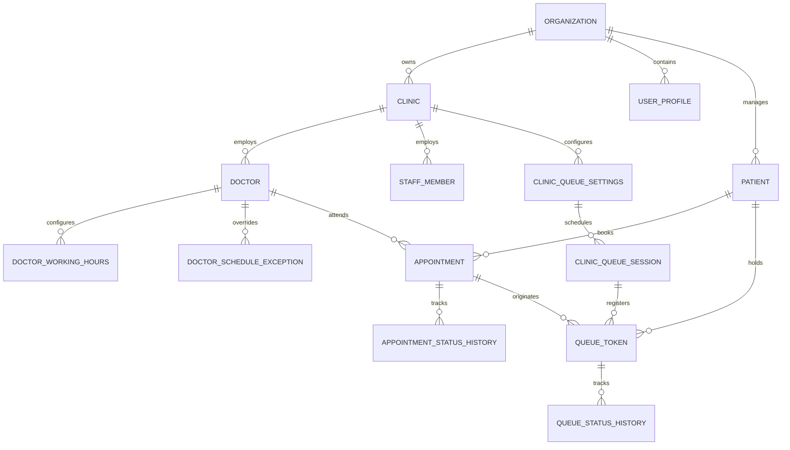

# MatabAI Database Schema & Architecture

## Overview
MatabAI uses PostgreSQL managed through Supabase with Prisma ORM v6. Multi-tenancy is enforced using hierarchical foreign keys (`organization_id`, `clinic_id`) backed by Row-Level Security (RLS) policies and NestJS execution-context guards (`TenantGuard`).

---

## Entity Relationship Overview



---

## Phase 4 Schema: Appointment Scheduling & Booking Engine

### 1. `doctor_working_hours`
Defines recurring weekly availability blocks for doctors at specific clinics.

| Column | Type | Constraints | Description |
| :--- | :--- | :--- | :--- |
| `id` | `UUID` | PK, default `gen_random_uuid()` | Primary Key |
| `organization_id` | `UUID` | FK -> `organizations(id)` | Multi-tenant owner |
| `clinic_id` | `UUID` | FK -> `clinics(id)` | Operating clinic location |
| `doctor_id` | `UUID` | FK -> `doctors(id)` | Attending doctor |
| `day_of_week` | `INT` | 0-6 (0=Sun, 1=Mon, ..., 6=Sat) | Day of week |
| `start_time` | `VARCHAR(5)` | `HH:mm` format | Shift start time |
| `end_time` | `VARCHAR(5)` | `HH:mm` format | Shift end time (must be > `start_time`) |
| `slot_duration_minutes` | `INT` | > 0 (e.g. 15, 20, 30, 45, 60) | Duration per appointment slot |
| `break_start_time` | `VARCHAR(5)` | Nullable, `HH:mm` format | Break/lunch start time |
| `break_end_time` | `VARCHAR(5)` | Nullable, `HH:mm` format | Break/lunch end time (must be > `break_start_time`) |
| `effective_from` | `TIMESTAMPTZ` | NOT NULL | Date rule becomes effective |
| `effective_until` | `TIMESTAMPTZ` | Nullable | Optional expiration date |
| `is_active` | `BOOLEAN` | Default `true` | Active status toggle |
| `created_at` | `TIMESTAMPTZ` | Default `now()` | Record creation timestamp |
| `updated_at` | `TIMESTAMPTZ` | Updated on change | Record update timestamp |

**Business Constraints:**
- Overlapping active working periods for the same `doctor_id`, `clinic_id`, and `day_of_week` are prohibited server-side.
- Break intervals must be strictly contained within `[start_time, end_time]`.

---

### 2. `doctor_schedule_exceptions`
Captures dates where standard working hours do not apply (holidays, personal leave, or custom modified hours).

| Column | Type | Constraints | Description |
| :--- | :--- | :--- | :--- |
| `id` | `UUID` | PK, default `gen_random_uuid()` | Primary Key |
| `organization_id` | `UUID` | FK -> `organizations(id)` | Multi-tenant owner |
| `clinic_id` | `UUID` | FK -> `clinics(id)` | Operating clinic location |
| `doctor_id` | `UUID` | FK -> `doctors(id)` | Doctor with override |
| `exception_date` | `DATE` | NOT NULL | YYYY-MM-DD date |
| `exception_type` | `VARCHAR(20)` | `UNAVAILABLE` \| `CUSTOM_HOURS` | Exception behavior |
| `start_time` | `VARCHAR(5)` | Nullable, required for `CUSTOM_HOURS` | Override start time |
| `end_time` | `VARCHAR(5)` | Nullable, required for `CUSTOM_HOURS` | Override end time |
| `reason` | `TEXT` | Nullable | Reason (e.g. National Holiday, Medical Leave) |
| `created_at` | `TIMESTAMPTZ` | Default `now()` | Record creation timestamp |
| `updated_at` | `TIMESTAMPTZ` | Updated on change | Record update timestamp |

---

### 3. `appointments`
Tracks outpatient bookings, scheduled timings, booking source, and lifecycle states.

| Column | Type | Constraints | Description |
| :--- | :--- | :--- | :--- |
| `id` | `UUID` | PK, default `gen_random_uuid()` | Primary Key |
| `organization_id` | `UUID` | FK -> `organizations(id)` | Multi-tenant owner |
| `clinic_id` | `UUID` | FK -> `clinics(id)` | Operating clinic location |
| `doctor_id` | `UUID` | FK -> `doctors(id)` | Attending doctor |
| `patient_id` | `UUID` | FK -> `patients(id)` | Booked patient |
| `appointment_number` | `VARCHAR(32)` | UNIQUE, NOT NULL | Deterministic identifier `APT-YYYY-XXXX` |
| `appointment_date` | `DATE` | NOT NULL | Scheduled appointment date |
| `start_time` | `VARCHAR(5)` | NOT NULL, `HH:mm` format | Slot start time |
| `end_time` | `VARCHAR(5)` | NOT NULL, `HH:mm` format | Slot end time |
| `timezone` | `VARCHAR(64)` | Default `Asia/Karachi` | Clinic timezone |
| `status` | `VARCHAR(20)` | `PENDING`, `CONFIRMED`, `CANCELLED`, `COMPLETED`, `NO_SHOW`, `IN_PROGRESS` | Lifecycle state |
| `booking_source` | `VARCHAR(20)` | `MANUAL`, `ONLINE`, `WHATSAPP`, `VOICE_AI`, `WALK_IN` | Ingestion channel |
| `reason_for_visit` | `TEXT` | Nullable | Patient's primary complaint |
| `internal_notes` | `TEXT` | Nullable | Staff/reception internal notes |
| `cancellation_reason` | `TEXT` | Nullable | Required on cancellation |
| `created_by` | `UUID` | NOT NULL | User who booked |
| `cancelled_by` | `UUID` | Nullable | User who cancelled |
| `rescheduled_from_id` | `UUID` | Nullable, FK -> `appointments(id)` | Audit trail of previous appointment |
| `created_at` | `TIMESTAMPTZ` | Default `now()` | Record creation timestamp |
| `updated_at` | `TIMESTAMPTZ` | Updated on change | Record update timestamp |

---

### 4. `appointment_status_history`
Append-only audit trail capturing every state change throughout an appointment's lifecycle.

| Column | Type | Constraints | Description |
| :--- | :--- | :--- | :--- |
| `id` | `UUID` | PK, default `gen_random_uuid()` | Primary Key |
| `appointment_id` | `UUID` | FK -> `appointments(id)` | Target appointment |
| `organization_id` | `UUID` | FK -> `organizations(id)` | Multi-tenant owner |
| `clinic_id` | `UUID` | FK -> `clinics(id)` | Clinic location |
| `previous_status` | `VARCHAR(20)` | Nullable | Previous state |
| `new_status` | `VARCHAR(20)` | NOT NULL | Transitioned state |
| `changed_by` | `UUID` | NOT NULL | User ID who performed transition |
| `change_reason` | `TEXT` | Nullable | Reason note |
| `created_at` | `TIMESTAMPTZ` | Default `now()` | Audit record timestamp |

---

## Phase 5 Schema: Digital Token & Real-Time Queue Management

### 1. `clinic_queue_settings`
Configures operational queue parameters for specific clinic branches or doctor consultation rooms.

| Column | Type | Constraints | Description |
| :--- | :--- | :--- | :--- |
| `id` | `UUID` | PK, default `gen_random_uuid()` | Primary Key |
| `organization_id` | `UUID` | FK -> `organizations(id)` | Multi-tenant owner |
| `clinic_id` | `UUID` | FK -> `clinics(id)` | Operating clinic location |
| `doctor_id` | `UUID` | Nullable, FK -> `doctors(id)` | Optional doctor-dedicated queue |
| `queue_name` | `VARCHAR(100)` | NOT NULL | Queue display name (e.g. "General OPD") |
| `token_prefix` | `VARCHAR(5)` | Default `'A'` | Prefix character (e.g. A, B, OPD) |
| `token_reset_policy` | `VARCHAR(20)` | Default `'DAILY'` | Token reset rule |
| `allow_walk_ins` | `BOOLEAN` | Default `true` | Enables walk-in check-in |
| `allow_appointment_check_in`| `BOOLEAN` | Default `true` | Enables appointment check-in |
| `estimated_consultation_minutes` | `INT` | Default `15` | Average consultation duration |
| `max_queue_capacity` | `INT` | Nullable | Max tokens permitted per day |
| `public_queue_id` | `VARCHAR(64)` | UNIQUE, default UUID | High-entropy revocable public identifier |
| `is_public_display_enabled` | `BOOLEAN` | Default `true` | Public display monitor toggle |
| `is_active` | `BOOLEAN` | Default `true` | Queue active status |
| `created_at` | `TIMESTAMPTZ` | Default `now()` | Timestamp |
| `updated_at` | `TIMESTAMPTZ` | Updated on change | Timestamp |

---

### 2. `clinic_queue_sessions`
Captures daily operational queue sessions. Each session represents one queue instance on a clinic-local date.

| Column | Type | Constraints | Description |
| :--- | :--- | :--- | :--- |
| `id` | `UUID` | PK, default `gen_random_uuid()` | Primary Key |
| `organization_id` | `UUID` | FK -> `organizations(id)` | Multi-tenant owner |
| `clinic_id` | `UUID` | FK -> `clinics(id)` | Operating clinic location |
| `doctor_id` | `UUID` | Nullable, FK -> `doctors(id)` | Attending doctor |
| `queue_settings_id` | `UUID` | FK -> `clinic_queue_settings(id)`| Configuration reference |
| `session_date` | `VARCHAR(10)` | YYYY-MM-DD in clinic timezone | Session calendar day |
| `status` | `VARCHAR(20)` | `NOT_STARTED`, `ACTIVE`, `PAUSED`, `CLOSED` | Operational state |
| `last_token_number` | `INT` | Default `0` | Sequential counter |
| `current_token_number` | `INT` | Nullable | Active token called |
| `total_registered` | `INT` | Default `0` | Total tokens issued today |
| `total_completed` | `INT` | Default `0` | Total consultations finished |
| `started_at` | `TIMESTAMPTZ` | Nullable | Opening timestamp |
| `closed_at` | `TIMESTAMPTZ` | Nullable | Closing timestamp |
| `created_at` | `TIMESTAMPTZ` | Default `now()` | Timestamp |
| `updated_at` | `TIMESTAMPTZ` | Updated on change | Timestamp |

**Uniqueness & Integrity:**
- Unique compound constraint `[queue_settings_id, session_date]` ensures exactly one session exists per queue per day.
- A closed session cannot accept check-ins or issue new tokens.
- Closing a session while a patient is in `SERVING` status requires explicit administrative confirmation.

---

### 3. `queue_tokens`
Represents outpatient digital queue tokens issued to patients.

| Column | Type | Constraints | Description |
| :--- | :--- | :--- | :--- |
| `id` | `UUID` | PK, default `gen_random_uuid()` | Primary Key |
| `organization_id` | `UUID` | FK -> `organizations(id)` | Multi-tenant owner |
| `clinic_id` | `UUID` | FK -> `clinics(id)` | Operating clinic location |
| `queue_session_id` | `UUID` | FK -> `clinic_queue_sessions(id)`| Associated session |
| `appointment_id` | `UUID` | Nullable, FK -> `appointments(id)` | Linked appointment |
| `patient_id` | `UUID` | FK -> `patients(id)` | Patient recipient |
| `token_number` | `INT` | Sequential per session | Daily numeric token number |
| `token_display` | `VARCHAR(16)` | E.g. `A001`, `A002` | Formatted display token |
| `queue_position` | `INT` | Default `0` | Current 1-based waiting position |
| `status` | `VARCHAR(20)` | `WAITING`, `CALLED`, `SERVING`, `COMPLETED`, `SKIPPED`, `CANCELLED`, `NO_SHOW` | Token lifecycle |
| `priority_type` | `VARCHAR(20)` | `NORMAL`, `PRIORITY` | Triage priority |
| `checked_in_at` | `TIMESTAMPTZ` | Default `now()` | Arrival time |
| `called_at` | `TIMESTAMPTZ` | Nullable | When token was called |
| `service_started_at`| `TIMESTAMPTZ` | Nullable | Consultation start time |
| `completed_at` | `TIMESTAMPTZ` | Nullable | Consultation completion |
| `skipped_at` | `TIMESTAMPTZ` | Nullable | When patient was skipped |
| `cancelled_at` | `TIMESTAMPTZ` | Nullable | When token was cancelled |
| `estimated_wait_minutes` | `INT` | Nullable | Dynamic wait estimate |
| `notes` | `TEXT` | Nullable | Intake or triage notes |
| `created_at` | `TIMESTAMPTZ` | Default `now()` | Timestamp |
| `updated_at` | `TIMESTAMPTZ` | Updated on change | Timestamp |

**Concurrency & Anti-Duplicate Rules:**
- Compound unique index `[queue_session_id, token_number]`.
- Token numbers are atomically generated via interactive transaction `$transaction` reading and incrementing `last_token_number`.
- An appointment cannot receive duplicate active tokens.
- A patient cannot hold duplicate active tokens in the same queue session.

---

### 4. `queue_status_history`
Append-only audit trail capturing all token state transitions.

| Column | Type | Constraints | Description |
| :--- | :--- | :--- | :--- |
| `id` | `UUID` | PK, default `gen_random_uuid()` | Primary Key |
| `organization_id` | `UUID` | FK -> `organizations(id)` | Multi-tenant owner |
| `clinic_id` | `UUID` | FK -> `clinics(id)` | Clinic location |
| `queue_token_id` | `UUID` | FK -> `queue_tokens(id)` | Target token |
| `previous_status` | `VARCHAR(20)` | Nullable | Previous state |
| `new_status` | `VARCHAR(20)` | NOT NULL | Transitioned state |
| `changed_by` | `UUID` | NOT NULL | User ID who performed transition |
| `change_reason` | `TEXT` | Nullable | Transition reason |
| `created_at` | `TIMESTAMPTZ` | Default `now()` | Timestamp |

---

## Token Ordering & Wait-Time Algorithm

### Queue Ordering Logic
1. **Priority Tokens First:** Tokens flagged with `priority_type = PRIORITY` (elderly, pediatric, urgent triage).
2. **First-In First-Out (FIFO):** Within each priority level, ordered by `checked_in_at ASC`.
3. **Deterministic Tie-Breaker:** Ordered by `token_number ASC`.

### Estimated Waiting Time Formula
$$\text{Estimated Wait} = (\text{Queue Position} - 1) \times \text{Estimated Consultation Minutes}$$

When queue state transitions occur (`CALL_NEXT`, `SKIP`, `RESTORE`, `CANCEL`), positions and estimated wait times are automatically recalculated across all remaining waiting tokens.

---

## Row-Level Security (RLS) Policies

All Phase 4 & Phase 5 tables are protected by Postgres RLS:
```sql
ALTER TABLE clinic_queue_settings ENABLE ROW LEVEL SECURITY;
ALTER TABLE clinic_queue_sessions ENABLE ROW LEVEL SECURITY;
ALTER TABLE queue_tokens ENABLE ROW LEVEL SECURITY;
ALTER TABLE queue_status_history ENABLE ROW LEVEL SECURITY;
```
- Staff can only access queues within their assigned organization.
- Patients can only view their own tokens (`patient_id = current_user_patient_id`).
- Public waiting room displays access only minimal sanitized data via high-entropy `public_queue_id` without exposing private patient records.
