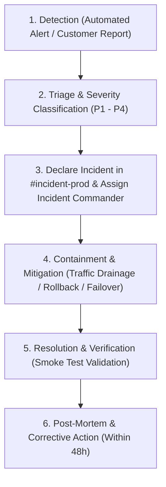

# Production Incident Response & Runbook — MatabAI (ShifaDesk)

This document provides step-by-step procedures, severity definitions, communication protocols, and diagnostic runbooks for responding to production incidents on MatabAI (ShifaDesk).

---

## 1. Incident Severity Matrix

| Severity | Definition | Target Response (MTTA) | Target Resolution (MTTR) | Escalation |
| :--- | :--- | :--- | :--- | :--- |
| **P1 - Critical** | Total platform outage, critical data corruption, active security breach, or failure of health probes across all replicas. | **< 5 minutes** | **< 30 minutes** | PagerDuty, Lead DevOps, CTO / Founder, All Engineering. |
| **P2 - High** | Major feature unavailable (e.g. Appointment booking down, WhatsApp webhook failure, SafePay gateway offline, EMR notes failing to save) for multiple clinics. | **< 15 minutes** | **< 2 hours** | On-call Engineer, Tech Lead. |
| **P3 - Medium** | Minor feature degradation (e.g. non-critical analytics query slow, scheduled report delayed) with available manual workarounds. | **< 1 hour** | **< 8 hours** | Responsible feature squad. |
| **P4 - Low** | Cosmetic frontend UI bug, minor formatting defect, non-blocking administrative issue. | **< 4 hours** | Next sprint | Jira backlog. |

---

## 2. Emergency Incident Response Workflow



---

## 3. Specific Operational Runbooks

### Runbook 1: API Cluster Down or Ingress 502/503 Errors
1. **Check Liveness Probe:**
   ```bash
   curl -i https://api.yourdomain.com/api/v1/health/live
   ```
   If liveness fails, inspect container orchestrator (ECS/Render/K8s) task status. Look for Out-Of-Memory (OOM) kills or unhandled startup crashes.
2. **Check Container Logs:**
   Filter logs by correlation ID or recent fatal errors:
   ```bash
   # AWS CloudWatch / Render CLI
   render logs --service matabai-api --limit 100
   ```
3. **Restart Service / Trigger Clean Rollout:**
   If unresponsive, trigger rolling restart of API tasks.
4. **Initiate Code Rollback:**
   If the failure began immediately after a deployment, execute the Rollback Procedure immediately (`docs/production/ROLLBACK_PROCEDURE.md`).

### Runbook 2: Database Connection Pool Exhaustion
1. **Symptom:** `PrismaClientInitializationError: Timed out waiting for connection from pool` or `503 Service Unavailable` on `/ready`.
2. **Diagnostic Check:**
   Query Supabase / RDS active connection metrics:
   ```sql
   SELECT count(*), state FROM pg_stat_activity GROUP BY state;
   ```
3. **Immediate Mitigation:**
   - Terminate idle or long-running transactions:
     ```sql
     SELECT pg_terminate_backend(pid) FROM pg_stat_activity WHERE state = 'idle in transaction' AND state_change < now() - INTERVAL '5 minutes';
     ```
   - Verify PgBouncer connection pooling is active on port `6543`. Ensure API instances are NOT connecting directly to port `5432`.
   - Scale API replica count down temporarily if database max connections is saturated.

### Runbook 3: External Gateway Provider Outage (Meta / Twilio / Safepay)
1. **Symptom:** Webhook timeouts or failure responses from external providers.
2. **Action:**
   - Confirm external provider status (e.g. Meta Status, Twilio Status, Safepay Status).
   - In MatabAI, adapters fail gracefully and queue pending notifications in `NotificationJob` with exponential backoff (`status: FAILED, retryCount++`).
   - Post public status notice in clinic portal advising staff that WhatsApp/SMS notifications are currently queued for automatic retry.

---

## 4. Post-Incident Review Protocol (Blameless Post-Mortem)
Every P1 or P2 incident requires a formal blameless post-mortem completed within 48 hours:
1. **Timeline:** Exact chronological sequence of events (T0 detection to recovery).
2. **Root Cause Analysis (5 Whys):** The underlying systemic flaw that allowed the failure.
3. **Impact:** Number of affected clinics, patients, and missed appointments.
4. **Action Items:** Prevention tickets filed in sprint backlog with assigned owners.
