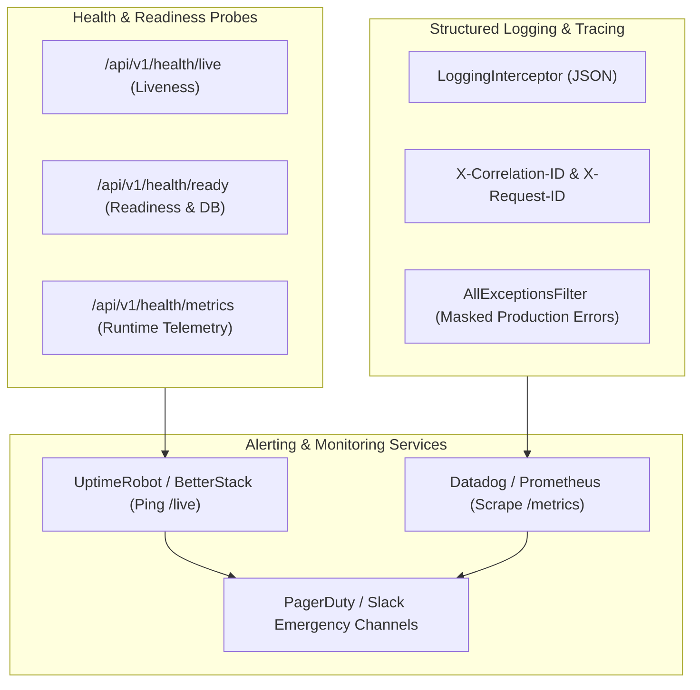

# Monitoring, Telemetry & Observability — MatabAI (ShifaDesk)

This document establishes the production monitoring, distributed tracing, structured logging, health probes, and alerting rules for MatabAI (ShifaDesk).

---

## 1. Observability Pillars



---

## 2. Health & Telemetry Endpoints

All probes are located under the API namespace `/api/v1/health`:

### 2.1 Liveness Probe (`GET /api/v1/health/live`)
- **Purpose:** Used by Kubernetes or container orchestrators (AWS ECS, Docker Swarm) to know when to restart a crashed or frozen container.
- **Criteria:** Verifies that the Node.js event loop is unblocked and responsive.
- **Performance:** Responds in < 5ms.
- **Response Format:**
  ```json
  {
    "status": "ok",
    "uptimeSeconds": 3482,
    "timestamp": "2026-11-18T05:00:00.000Z"
  }
  ```

### 2.2 Readiness Probe (`GET /api/v1/health/ready`)
- **Purpose:** Used by edge load balancers (Cloudflare, AWS ALB) to determine whether to route production traffic to this replica.
- **Criteria:** Performs a live query to PostgreSQL/Supabase and checks private encrypted report storage accessibility.
- **Status Codes:**
  - `200 OK`: All dependencies healthy. Ready to serve traffic.
  - `503 Service Unavailable`: Database unreachable or storage error. Load balancer drains traffic from this replica.
- **Response Format:**
  ```json
  {
    "status": "ready",
    "database": "connected",
    "storage": "accessible",
    "timestamp": "2026-11-18T05:00:00.000Z"
  }
  ```

### 2.3 Operational Metrics Probe (`GET /api/v1/health/metrics`)
- **Purpose:** Telemetry metrics collection for Prometheus / Grafana / Datadog.
- **Payload:**
  - `memory.heapUsedMb`: Active V8 heap consumption.
  - `memory.heapTotalMb`: Total allocated V8 heap.
  - `memory.rssMb`: Total resident set size.
  - `uptimeSeconds`: Seconds since process initiation.
  - `nodeVersion`: Node.js runtime version.
  - `timestamp`: Current server ISO 8601 timestamp.

---

## 3. Distributed Tracing & Correlation IDs

Every inbound HTTP request is assigned a unique correlation ID:
1. If client supplies `X-Correlation-ID` or `X-Request-ID`, it is preserved.
2. Otherwise, `LoggingInterceptor` generates a cryptographically random UUID v4 (`corr-<uuid>`).
3. The ID is injected into the response headers as `X-Correlation-ID`.
4. All logs emitted during the lifecycle of the request are structured JSON tagged with `correlationId`.

---

## 4. Alerting Thresholds & Notification Channels

| Metric / Event | Severity | Alert Channel | Trigger Condition |
| :--- | :--- | :--- | :--- |
| **API Liveness Down** | **P1 (Critical)** | PagerDuty + SMS | 2 consecutive failed `/live` checks (30s) |
| **Readiness 503** | **P1 (Critical)** | PagerDuty + Slack `#alerts-prod` | > 50% replicas failing `/ready` for 1 min |
| **High Error Rate (5xx)** | **P2 (High)** | Slack `#alerts-prod` | > 2% of total requests returning 5xx over 5 mins |
| **P95 Latency Spike** | **P2 (High)** | Slack `#alerts-prod` | P95 latency > 500ms for 3 consecutive minutes |
| **High Memory Usage** | **P3 (Warning)** | Slack `#ops-telemetry` | Process RSS > 85% of container allocation |
| **External Adapter Blocked** | **P4 (Info)** | Slack `#integrations` | External provider unconfigured warning on startup |
