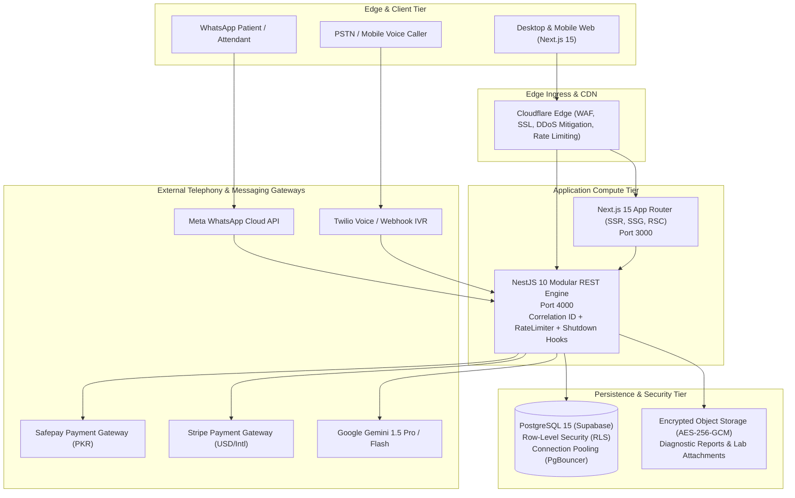

# Production Architecture — MatabAI (ShifaDesk)

## 1. System Overview

MatabAI (ShifaDesk) is an enterprise-grade, multi-tenant healthcare operating system and Electronic Medical Records (EMR-Lite) platform built for clinics, polyclinics, diagnostic laboratories, and hospital outpatient departments. It integrates multilingual conversational AI (WhatsApp, Voice telephony IVR), real-time digital queue management, doctor appointment scheduling, diagnostic laboratory management, dual-currency financial invoicing, clinical encounter documentation, executive business intelligence, and SaaS subscription licensing.



---

## 2. Infrastructure Tiers

### 2.1 Web Application Tier (`apps/web`)
- **Framework:** Next.js 15.2.8 (React 19, App Router, React Server Components).
- **Hosting Strategy:** Vercel Pro or Containerized Docker on AWS ECS / Render.
- **Port:** `3000` (internal).
- **Security Headers:**
  - `Content-Security-Policy`: Restricts scripts, styles, fonts, frames, and connect endpoints.
  - `Strict-Transport-Security`: `max-age=63072000; includeSubDomains; preload`.
  - `X-Frame-Options`: `DENY` to prevent clickjacking.
  - `X-Content-Type-Options`: `nosniff`.
  - `Referrer-Policy`: `strict-origin-when-cross-origin`.
  - `Permissions-Policy`: `camera=(), microphone=(), geolocation=()`.

### 2.2 API Application Tier (`apps/api`)
- **Framework:** NestJS 10 (Fast, scalable TypeScript backend on Express).
- **Hosting Strategy:** Containerized Docker on AWS ECS / Render / Railway / Google Cloud Run.
- **Port:** `4000` (configurable via `PORT` environment variable).
- **Runtime Characteristics:**
  - **Memory Allocation:** Standard 512 MB to 1 GB RAM per replica; autoscales at 70% CPU or 75% memory.
  - **Graceful Termination:** Intercepts `SIGTERM` and `SIGINT`, halts traffic ingress, drains active requests within `SHUTDOWN_TIMEOUT_MS=15000`, cleanly disconnects Prisma ORM pools.
  - **Rate Limiting:** In-memory sliding-window bucket algorithm with per-IP and per-tenant burst protection.
  - **Observability:** Structured JSON logging (`LOG_FORMAT=json`) with distributed `X-Correlation-ID` header tracing.

### 2.3 Database Tier (PostgreSQL / Supabase)
- **Engine:** PostgreSQL 15+ hosted on Supabase (or managed AWS RDS PostgreSQL).
- **Multi-Tenancy Architecture:**
  - Tenant isolation enforced through `organizationId` and `clinicId` foreign keys on all domain entities.
  - Row-Level Security (RLS) policies implemented on critical patient, clinical, and financial tables.
- **Connection Management:**
  - Transaction connection pooling via PgBouncer (`PORT=6543`, `sslmode=require`).
  - Direct connection reserved strictly for migration execution and schema synchronization (`PORT=5432`).
- **Connection Budgeting:**
  - Default pool per API replica: `connection_limit=20`.
  - Max pool reserve for worker tasks: 5 connections.

### 2.4 Diagnostic Storage Tier
- **Strategy:** Local secured storage in staging/development; S3-compatible encrypted private bucket in production.
- **Security:** AES-256-GCM symmetric encryption applied at rest before writing to disk/object storage.
- **Access Protocol:** Time-limited signed HMAC tokens (`/reports/access/:token`) with mandatory patient phone number verification (`/reports/access/:token/verify`). Direct file paths are never exposed publicly.

---

## 3. High Availability & Scalability Model

### 3.1 Redundancy
- **API Multi-Replica:** Minimum 2 replicas running across distinct availability zones behind a cloud load balancer.
- **Stateless Application:** API instances maintain zero in-memory user session state; JWT tokens and database persistence ensure any replica can process any incoming request.
- **Health Probes:**
  - `GET /api/v1/health/live`: Fast liveness check (<5ms) responding `200 OK` as long as event loop is responsive.
  - `GET /api/v1/health/ready`: Deep dependency readiness check verifying PostgreSQL connection pool and private storage access. Returns `503 Service Unavailable` if dependencies fail, triggering automatic load balancer traffic drainage.

### 3.2 Performance Targets & SLA
| Metric | Target | Failover Threshold |
| :--- | :--- | :--- |
| **Uptime SLA** | 99.9% availability | < 99.5% triggers high-severity incident |
| **P50 Latency** | < 45 ms (read), < 85 ms (write) | > 150 ms |
| **P95 Latency** | < 180 ms | > 400 ms |
| **P99 Latency** | < 350 ms | > 800 ms |
| **RPO (Recovery Point Objective)** | 1 hour | > 2 hours |
| **RTO (Recovery Time Objective)** | 15 minutes | > 30 minutes |

---

## 4. Network & Security Topology

```
+-------------------------------------------------------------+
| Internet / Public WAN                                       |
+------------------------------+------------------------------+
                               |
                               v
+-------------------------------------------------------------+
| Cloudflare Edge Network (TLS 1.3 Termination, WAF, DDoS)     |
+------------------------------+------------------------------+
                               |
          +--------------------+--------------------+
          | (HTTPS 443)                             | (HTTPS 443)
          v                                         v
+-----------------------+                 +-----------------------+
| Web App (Next.js 15)  |                 | API Engine (NestJS 10)|
| Public Ingress        |                 | Rate Limiting & Auth  |
+-----------------------+                 +-----------+-----------+
                                                      |
                                 +--------------------+--------------------+
                                 | Private VPC (TLS)                       | Private VPC (TLS)
                                 v                                         v
                      +----------------------+                  +----------------------+
                      | PostgreSQL Pooler    |                  | S3 Encrypted Storage |
                      | (PgBouncer sslmode)  |                  | (AES-256-GCM)        |
                      +----------------------+                  +----------------------+
```

1. **Traffic Encryption:** All external and inter-service transit is encrypted via TLS 1.3 with modern cipher suites.
2. **Database Isolation:** Database port 5432/6543 is restricted via firewall security groups to accept connections exclusively from the authorized VPC or static IP of the application cluster.
3. **Secret Isolation:** API keys, database credentials, and symmetric encryption keys are injected at runtime via encrypted environment secrets (AWS Secrets Manager, Doppler, or GitHub Actions Environment Secrets).
