# Security Hardening & Zero-Trust Architecture — MatabAI (ShifaDesk)

This document details the security architecture, threat model, compliance mechanisms, and zero-trust controls implemented across MatabAI (ShifaDesk).

---

## 1. Threat Model & Security Posture

As a multi-tenant healthcare SaaS managing Protected Health Information (PHI), patient records, clinical encounters, diagnostic reports, and financial transactions, MatabAI adheres to the principle of least privilege, defense-in-depth, and zero-trust verification.

```mermaid
flowchart LR
    subgraph IngressSecurity["Perimeter Security"]
        TLS["TLS 1.3 Termination"]
        WAF["WAF & Anti-DDoS"]
        HSTS["HSTS Preload & CSP"]
    end

    subgraph AppSecurity["Application Layer Security"]
        RateLimit["Sliding Window Rate Limiter"]
        JWT["Role-Based JWT Validation"]
        TenantGuard["Multi-Tenant Isolation Guard"]
    end

    subgraph DataSecurity["Data Protection Layer"]
        AES["AES-256-GCM Storage Encryption"]
        HMAC["HMAC Signed Report Access Tokens"]
        Audit["Immutable Audit Event Logging"]
    end

    IngressSecurity --> AppSecurity --> DataSecurity
```

---

## 2. Ingress & Perimeter Protection

### 2.1 HTTP Security Headers
Configured in `apps/web/next.config.mjs` and enforced across all responses:
- `Content-Security-Policy`:
  `default-src 'self'; script-src 'self' 'unsafe-eval' 'unsafe-inline'; style-src 'self' 'unsafe-inline'; img-src 'self' data: blob: https:; font-src 'self' data:; connect-src 'self' http://localhost:* ws://localhost:* https://*.supabase.co; frame-ancestors 'none';`
- `Strict-Transport-Security`: `max-age=63072000; includeSubDomains; preload`
- `X-Frame-Options`: `DENY`
- `X-Content-Type-Options`: `nosniff`
- `Referrer-Policy`: `strict-origin-when-cross-origin`
- `Permissions-Policy`: `camera=(), microphone=(), geolocation=()`

### 2.2 Rate Limiting Architecture
Configured via `RateLimitGuard` (`apps/api/src/common/guards/rate-limit.guard.ts`):
- **Algorithm:** In-memory sliding-window bucket algorithm with background memory eviction.
- **Headers:** Emits RFC-compliant `X-RateLimit-Limit`, `X-RateLimit-Remaining`, `X-RateLimit-Reset`, and `Retry-After` on HTTP 429.
- **Sensitive Endpoint Tiering:**
  - Standard API routes: 120 requests/minute.
  - Critical endpoints (`/auth/login`, `/onboarding/register`, `/reports/access/:token/verify`): strictly throttled to 10 requests/minute.

---

## 3. Authentication & Multi-Tenant Authorization

### 3.1 Role-Based Access Control (RBAC)
- 7 hierarchical user roles: `SUPER_ADMIN`, `CLINIC_ADMIN`, `DOCTOR`, `RECEPTIONIST`, `LAB_TECHNICIAN`, `ACCOUNTANT`, `PATIENT`.
- Validated via `JwtAuthGuard` and `RolesGuard`.
- Tokens carry `sub`, `email`, `role`, `organizationId`, and accessible `clinicIds`.

### 3.2 Tenant Isolation (Defense-in-Depth)
1. **Application Query Scoping:** Every domain query (`Doctor`, `Patient`, `Appointment`, `Invoice`, `Encounter`, `LabOrder`) strictly enforces `where: { clinicId }` or `where: { organizationId }` derived from the validated JWT token.
2. **Database Row-Level Security (RLS):** Supabase PostgreSQL policies restrict access at the SQL engine level.
3. **Audit Trails:** All modifications, creations, deletions, and access attempts are logged immutably via `AuditService` with client IP, user agent, user ID, tenant ID, and action metadata.

---

## 4. Cryptographic Standards & Report Protection

### 4.1 Encryption at Rest (AES-256-GCM)
Diagnostic laboratory report attachments and sensitive clinical files are encrypted using authenticated symmetric encryption:
- **Algorithm:** AES-256-GCM.
- **IV / Nonce:** Unique 16-byte initialization vector generated per file via `crypto.randomBytes(16)`.
- **Authentication Tag:** 16-byte GCM authentication tag verifying payload integrity before decryption.

### 4.2 Time-Limited Report Access
Public or patient delivery of lab reports does not expose direct storage URLs:
1. System generates a cryptographically signed HMAC token (`/reports/access/:token`).
2. Recipient must verify their registered phone number (`/reports/access/:token/verify`).
3. Upon verification, report content is streamed decrypted directly with `Cache-Control: private, no-store`.

---

## 5. Vulnerability Management

- Monorepo dependencies are regularly scanned via `pnpm audit`.
- Critical Next.js advisories (GHSA-9qr9-h5gf-34mp and GHSA-f82v-jwr5-mffw) have been fully patched via Next.js `15.2.8`.
- Zero known high/critical CVEs in production dependencies.
