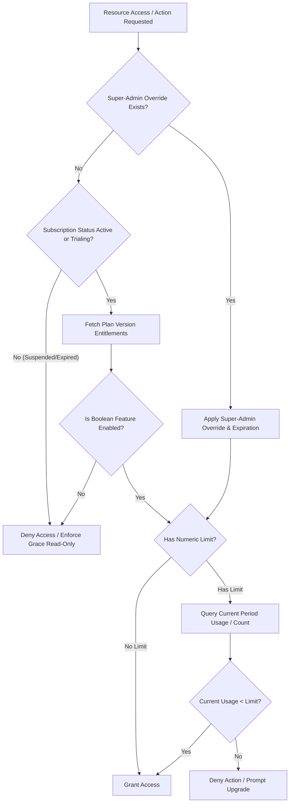
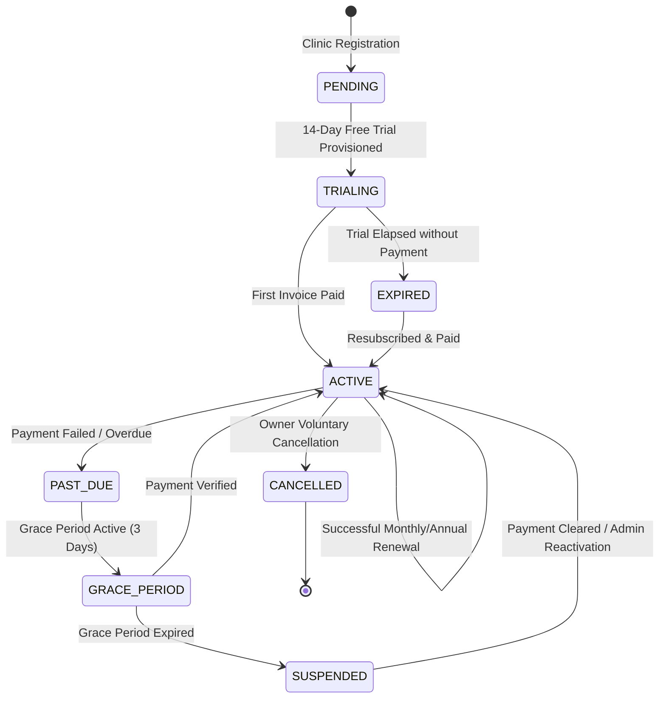

# MatabAI — SaaS Subscription Management, Tenant Onboarding & Platform Administration (Phase 14)

Founder: **Muhammad Talha**  
Platform: **MatabAI (ShifaDesk)**  
Phase: **Phase 14 — SaaS Subscription Management, Tenant Onboarding & Platform Administration**  
Architecture: **Multi-Tenant B2B Healthcare SaaS Platform**  

---

## 1. Executive Summary & SaaS Architecture Overview

Phase 14 transforms MatabAI from a multi-tenant clinic management system into a commercially deployable, enterprise-grade B2B Healthcare SaaS platform. The system introduces end-to-end self-service clinic onboarding, a complete multi-tier subscription engine, usage metering, versioned pricing in minor currency units (paisa), automated lifecycle transitions, automated notifications, and a centralized Super-Admin Platform Administration console.

```
+--------------------------------------------------------------------------------------------------+
|                                    MATABAI PLATFORM SUPER-ADMIN                                  |
|  [MRR / ARR Analytics]  [Tenant Directory]  [Plan Manager]  [Bank Payment Queue]  [Audit Logs]   |
+--------------------------------------------------------------------------------------------------+
                                                 |
                       Entitlement Enforcement & Lifecycle Transitions
                                                 |
+------------------------------------------------+-------------------------------------------------+
|                                                |                                                 |
|        ORGANIZATION A (Primary Care)           |         ORGANIZATION B (Diagnostic Center)      |
|  Plan: PROFESSIONAL (PKR 14,999/mo)            |  Plan: LABORATORY (PKR 19,999/mo)               |
|  Status: ACTIVE                                |  Status: TRIALING (14 Days)                     |
|                                                |                                                 |
|  +--------------------+---------------------+  |  +--------------------+----------------------+  |
|  | Clinic 1 (Main)    | Clinic 2 (Branch)   |  |  | Main Lab Branch    | Collection Center    |  |
|  +--------------------+---------------------+  |  +--------------------+----------------------+  |
|  | - Appointments     | - Tokens & Queue    |  |  | - Pathology Orders | - Report Access      |  |
|  | - Consultations    | - Patient Records   |  |  | - Phlebotomy & Spec| - Encrypted PDFs     |  |
|  | - WhatsApp AI      | - Voice Bot         |  |  | - Lab Technicians  | - Pathologist Review |  |
|  | - Local Invoices   | - Cash Register     |  |  | - Local Billing    | - Receipts           |  |
|  +--------------------+---------------------+  |  +--------------------+----------------------+  |
|                                                |                                                 |
|  Subscription Invoicing: SUB-YYYYMM-XXXX       |  Subscription Invoicing: SUB-YYYYMM-XXXX        |
|  Subscription Payments:  SPAY-YYYYMM-XXXX      |  Subscription Payments:  SPAY-YYYYMM-XXXX       |
+------------------------------------------------+-------------------------------------------------+
```

### Strict Financial Boundary Separation

MatabAI enforces an absolute boundary between **Clinic Operational Financials** (Phase 11) and **Platform SaaS Subscription Financials** (Phase 14):

| Domain | Scope | Numbering Prefix | Primary Entities | Users Involved |
| :--- | :--- | :--- | :--- | :--- |
| **Clinic Financials (Phase 11)** | Patient consultations, lab tests, medications, cash registers, refunds, expenses | `INV-YYYYMM-XXXX`<br>`PAY-YYYYMM-XXXX`<br>`CRS-YYYYMM-XXXX`<br>`EXP-YYYYMM-XXXX` | `Invoice`<br>`Payment`<br>`CashRegisterSession`<br>`Expense` | Patients, Clinic Receptionists, Cashiers, Doctors |
| **SaaS Financials (Phase 14)** | Platform subscription fees, plan upgrades, recurring billing, platform licenses | `SUB-YYYYMM-XXXX`<br>`SPAY-YYYYMM-XXXX` | `SubscriptionInvoice`<br>`SubscriptionPayment`<br>`PromotionalCredit` | Clinic Owners (`CLINIC_ADMIN`), Platform Super-Admins (`SUPER_ADMIN`) |

Under no circumstances are SaaS subscription invoices mixed with clinic patient revenue or reported in clinic outpatient cash flow statements.

---

## 2. Subscription Tiers, Pricing Model & Versioning

### Standard Tier Configurations

MatabAI provides three production-configured tiers seeded directly into the database:

| Tier | Code | Monthly Price | Annual Price (15% Disc.) | Max Doctors | Max Staff | Max Branches | WhatsApp MSGs / Mo | Voice Minutes / Mo |
| :--- | :--- | :---: | :---: | :---: | :---: | :---: | :---: | :---: |
| **Starter** | `STARTER` | PKR 4,999 *(499,900 paisa)* | PKR 50,990 *(5,099,000 paisa)* | 2 | 5 | 1 | 500 | 0 |
| **Professional** | `PROFESSIONAL` | PKR 14,999 *(1,499,900 paisa)* | PKR 152,990 *(15,299,000 paisa)* | 10 | 25 | 3 | 2,500 | 300 |
| **Laboratory** | `LABORATORY` | PKR 19,999 *(1,999,900 paisa)* | PKR 203,990 *(20,399,000 paisa)* | 5 | 30 | 5 | 3,000 | 100 |

### Integer Minor Units (Paisa) Architecture

To prevent floating-point rounding errors and ensure financial reconciliation accuracy, all monetary values in the SaaS platform are stored, calculated, and billed in integer **paisa** ($1 \text{ PKR} = 100 \text{ paisa}$):
- `monthlyPricePaisa`: `499900`
- `annualPricePaisa`: `5099000`
- `subtotalPaisa`, `taxPaisa`, `discountPaisa`, `totalPaisa`, `amountPaidPaisa`, `outstandingPaisa`

### Plan Versioning

When a platform administrator modifies plan pricing or limits:
1. A new `SubscriptionPlanVersion` record is created with an incremented version integer (`version: 2`).
2. Existing active tenant subscriptions remain locked to their signed version (`planVersionId`), preserving contracted rates.
3. New signups and renewing/upgrading tenants automatically bind to the latest published version.

---

## 3. Feature Entitlements & Metering Engine

### 19 Granular Feature Codes

Feature access is controlled via `FeatureCode` enums checked by `EntitlementService` and `EntitlementGuard`:

1. `APPOINTMENTS_BASIC`: Core scheduling calendar.
2. `APPOINTMENTS_ADVANCED`: Recurring slots, schedule exceptions, double-booking lock.
3. `QUEUE_MANAGEMENT`: Priority FIFO digital queue, token display.
4. `WHATSAPP_RECEPTIONIST`: Inbound Meta Cloud API multilingual AI agent.
5. `VOICE_RECEPTIONIST`: Inbound telephony IVR & AI voice assistant.
6. `EMR_LITE`: Consultation encounters, medical history, clinical notes.
7. `PRESCRIPTION_MANAGEMENT`: Rx authoring, medication catalog, printed layouts.
8. `LABORATORY_MANAGEMENT`: Outpatient lab catalog, specimens, reports.
9. `BILLING_INVOICING`: Clinic patient invoices, cash drawers, refunds.
10. `ANALYTICS_BASIC`: Core operational KPIs.
11. `ANALYTICS_ADVANCED`: Financial breakdown, turnaround times, multi-domain BI.
12. `CUSTOM_BRANDING`: Custom clinic logos and branding headers on reports and receipts.
13. `MULTI_BRANCH`: Creation of secondary branch clinics.
14. `API_ACCESS`: External REST API key access.
15. `DATA_EXPORT`: CSV, Excel, and PDF scheduled exports.
16. `AUDIT_LOGS`: Tamper-evident operational audit logs.
17. `PRIORITY_SUPPORT`: Elevated SLA support routing.
18. `TELEMEDICINE`: Remote consultation integration.
19. `PATIENT_PORTAL`: Patient-facing appointment, token, and report tracking.

### Entitlement Hierarchy & Resolution Algorithm

When verifying if a tenant can access a feature or create a resource:


### Usage Metering Engine

- `UsageMeteringService` records discrete usage events (`UsageEvent`) with idempotent deduplication keys (e.g. `whatsapp_msg_<wamid>`).
- Aggregates usage into rolling monthly windows (`UsagePeriodSummary`) for fast telemetry and dashboard charts.
- Provides real-time percentage consumption tracking with automatic warnings when exceeding 80% and 100% of plan quotas.

---

## 4. Tenant Lifecycle State Machine



### Lifecycle Status Definitions

- `PENDING`: Initial registration initiated; pending email or organization setup.
- `TRIALING`: Full feature access granted for 14 calendar days. No payment method required upfront.
- `ACTIVE`: Fully paid subscription with active renewal schedule.
- `PAST_DUE`: Renewal invoice issued but uncollected past due date.
- `GRACE_PERIOD`: 3-day buffer permitting continued clinic operations while payment issues are rectified.
- `SUSPENDED`: Administrative or non-payment lock. Clinic staff receive read-only notices; outbound communications are paused. Data is preserved indefinitely.
- `CANCELLED`: Subscription terminated by tenant. Access continues until `currentPeriodEnd`.
- `EXPIRED`: Unconverted trial or non-renewed subscription past grace period.

### Safe Downgrade Capacity Validation

Downgrading a subscription (e.g. from `PROFESSIONAL` to `STARTER`) executes a strict pre-flight capacity check:
1. Counts currently active doctors, staff members, and branches.
2. Compares active counts against the target plan limits (e.g. `STARTER` allows max 2 doctors).
3. If active resources exceed target limits, the downgrade is rejected with an informative error stating exactly which resources must be deactivated before the plan can be changed.
4. Clinic data is **never silently or automatically deleted**.

---

## 5. SaaS Billing & Invoice Lifecycle

### Invoice Model (`SubscriptionInvoice`)

- Sequential numbering: `SUB-YYYYMM-XXXX` (e.g. `SUB-202611-0001`).
- Line items categorized by `SaasInvoiceItemType`:
  - `PLAN_FEE`: Base recurring plan cost.
  - `ADDON`: Extra user licenses or dedicated phone lines.
  - `OVERAGE`: Additional WhatsApp messages or voice minutes.
  - `DISCOUNT`: Promotional codes or multi-month discounts.
  - `TAX`: Sales tax or regulatory surcharge.
  - `PRORATION_CREDIT`: Unused time credited during mid-cycle plan upgrades.
- Statuses: `DRAFT`, `ISSUED`, `PAID`, `VOID`, `UNCOLLECTIBLE`.

### Proration Math Example

When a clinic upgrades from `STARTER` (PKR 4,999/mo) to `PROFESSIONAL` (PKR 14,999/mo) 10 days into a 30-day month:
1. Remaining unused days on Starter: $20 / 30 \times 499,900 \text{ paisa} = 333,267 \text{ paisa}$.
2. Professional charge for 20 days: $20 / 30 \times 1,499,900 \text{ paisa} = 999,933 \text{ paisa}$.
3. Net invoice total: $999,933 - 333,267 = 666,666 \text{ paisa}$ (PKR 6,666.66).

---

## 6. Payment Processing & Verification

### Supported Payment Methods

1. **Bank Transfer / Cheque (`BANK_TRANSFER`)**:
   - The primary B2B payment channel in Pakistan.
   - Clinic submits transfer receipt: bank name, sender account, deposit slip number, and transaction image/URL.
   - Payment record created in `PENDING` status.
   - Appears in Super-Admin Review Queue (`/dashboard/platform/payments`).
   - Super-Admin approval automatically marks the invoice `PAID`, updates subscription to `ACTIVE`, extends period dates, and dispatches a confirmation alert.
2. **Online Card / Wallet Gateway (`CARD`)**:
   - Configured with official Safepay Pakistan payment gateway adapter.
   - Secure server-to-server webhook verification.
   - Unconfigured gateway handling: If `SAFEPAY_API_KEY` is not present in environment, returns explicit `BLOCKED: Safepay gateway credentials not configured` without simulating successful transactions.
3. **Promotional Credits (`PROMOTIONAL_CREDIT`)**:
   - Platform credits issued by Super-Admins applied toward recurring renewals.

---

## 7. Super-Admin Platform Console

Accessible exclusively to users with `PLATFORM_MANAGE` permission (`SUPER_ADMIN` role):

- `/dashboard/platform`: Executive dashboard showing MRR, ARR, active subscribers, trial conversion rate, and revenue charts.
- `/dashboard/platform/tenants`: Directory of all registered clinics, subscription states, manual suspension, trial extension, and feature override controls.
- `/dashboard/platform/plans`: Dynamic plan tier pricing, entitlement limit adjustments, and plan versioning.
- `/dashboard/platform/payments`: Queue of submitted bank transfers with one-click verification or rejection.
- `/dashboard/platform/invoices`: Global repository of all SaaS subscription invoices with printable receipts.
- `/dashboard/platform/audit-logs`: Comprehensive audit ledger recording all administrative interventions, overrides, and status modifications.

---

## 8. Notification Engine Integration

Phase 14 connects with the Phase 8 `NotificationSchedulerService` to dispatch automated operational and financial alerts across WhatsApp, In-App, and Email:

| Event | Recipients | Description |
| :--- | :--- | :--- |
| `SUBSCRIPTION_WELCOME` | Clinic Administrator | Dispatched upon self-registration with onboarding link. |
| `TRIAL_STARTED` | Clinic Administrator | Confirmation of 14-day trial and entitlement summary. |
| `TRIAL_EXPIRING_SOON` | Clinic Administrator | Sent 3 days prior to trial conclusion with payment instructions. |
| `SUBSCRIPTION_ACTIVATED` | Clinic Administrator | Sent immediately upon invoice payment clearance. |
| `SUBSCRIPTION_UPGRADED` | Clinic Administrator | Details new plan limits, prorated fee, and immediate activation. |
| `SAAS_INVOICE_ISSUED` | Clinic Administrator | Recurring bill notice with due date and payment link. |
| `PAYMENT_RECEIVED` | Clinic Administrator | Formal payment confirmation with printable receipt link. |
| `SUBSCRIPTION_SUSPENDED` | Clinic Administrator | Non-payment or administrative lock notification. |

---

## 9. Row-Level Security (RLS) & Multi-Tenant Isolation

15 PostgreSQL tables added to `infrastructure/database/rls-policies.sql`:
1. `subscription_plans` & `subscription_plan_versions`: Public read for active plans; platform write.
2. `tenant_subscriptions` & `subscription_invoices`: Isolated by `organization_id` using `auth.jwt() -> app_metadata -> organization_id`.
3. `platform_admin_audit_logs`: Restricted to Super-Admins (`SUPER_ADMIN`).

Tenant users are strictly prevented from querying or mutating other clinics' subscription records, usage summaries, or payment submissions.

---

## 10. Automated Test Coverage & Verification

Phase 14 includes 6 comprehensive backend test suites in `apps/api/src/modules/saas/`:
- `tenant-onboarding.spec.ts`: Self-registration, duplicate prevention, and onboarding step transitions.
- `plan-entitlement.spec.ts`: Plan definitions, versioning, entitlement limits, and override logic.
- `subscription-lifecycle.spec.ts`: Trial startup, payment activation, upgrades, safe downgrades, and cancellations.
- `saas-billing-payment.spec.ts`: Invoice generation, paisa calculations, proration credits, bank transfer approval, and gateway checks.
- `usage-metering.spec.ts`: Usage event telemetry, rolling period rollups, and quota thresholds.
- `platform-admin.spec.ts`: Platform KPI aggregation, tenant suspension, trial extension, and audit logging.

**Test Results:**
- SaaS module: **6 / 6 suites passed (24 / 24 tests, 100%)**.
- Full Monorepo: **56 / 56 test suites passed (311 / 311 tests, 100%)**.
- Web Frontend: All Next.js 15 pages and components compiled with 0 errors.
